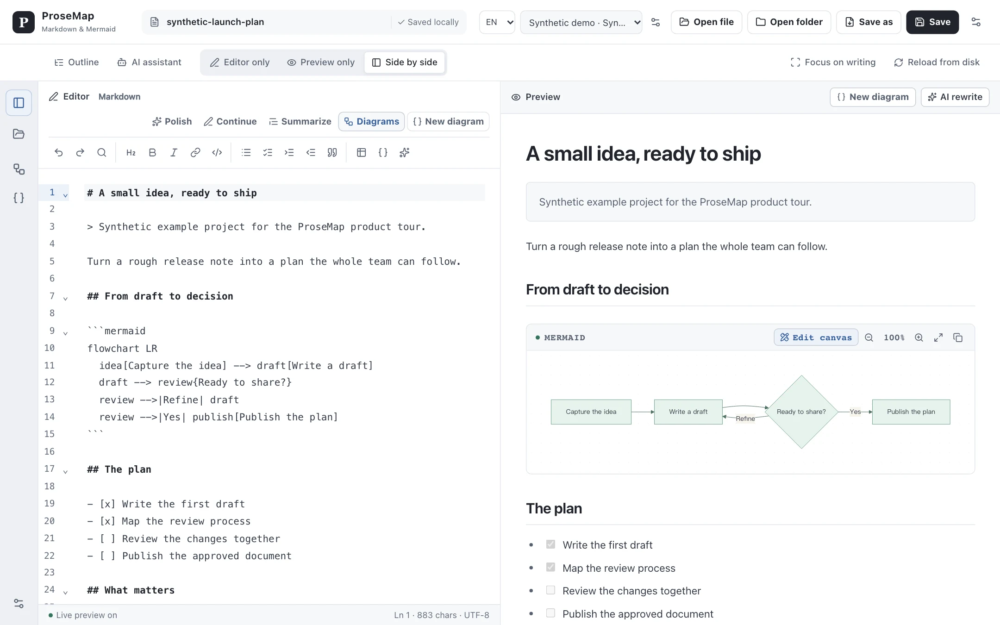
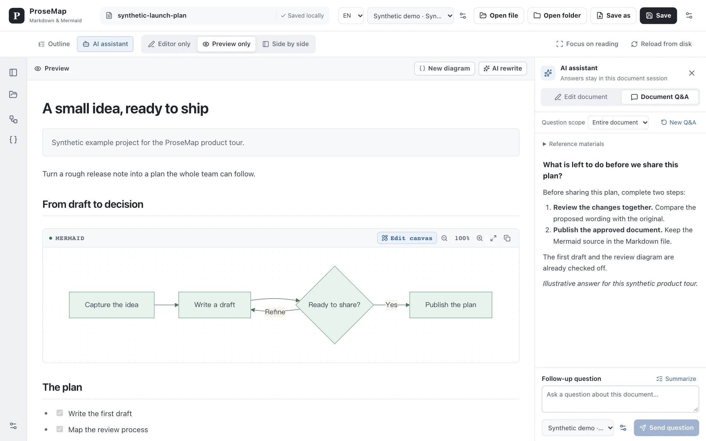
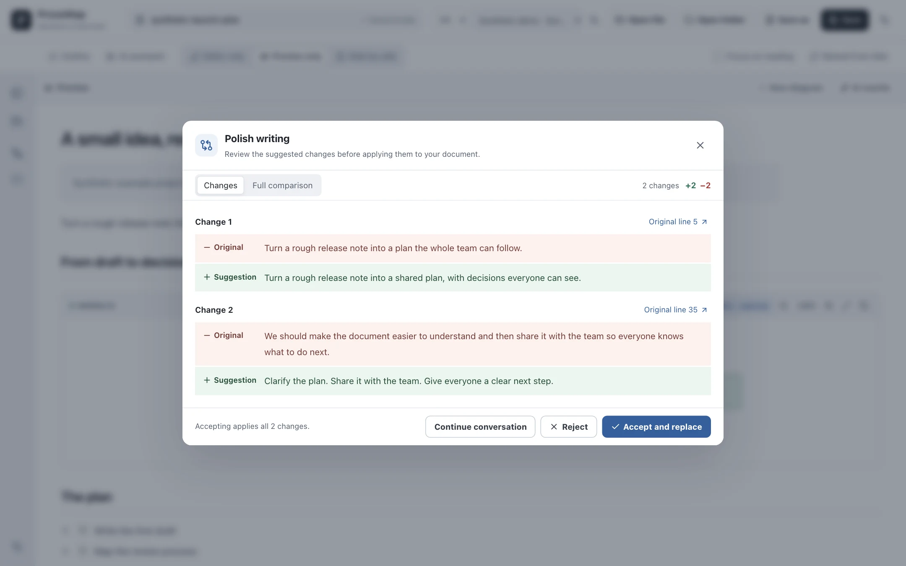

# ProseMap

**English** | [简体中文](README.zh-CN.md)

### Write the thought. See the whole picture.

**A local-first Markdown and Mermaid desktop workspace.** Write in focus, turn ideas into editable diagrams, ask questions as you read, and review AI suggestions before they touch your document.

[Explore the product page](https://kobe8bryant24lakers.github.io/prosemap/) · [Download v0.16.0](https://github.com/kobe8bryant24lakers/prosemap/releases/tag/v0.16.0) · [User guide](docs/guide.md)



Your next README, architecture note, or project plan can start with one ordinary `.md` file.

## One document. More ways to think.

| When you want to… | ProseMap helps you… |
| --- | --- |
| Get an idea onto the page | Write with live preview, an outline, formatting shortcuts, syntax highlighting, and code-block formatting. Switch to focused writing or reading when you need room to think. |
| Explain how something works | Build a Mermaid diagram from a template, source, or an AI draft. Move nodes, connect ideas, search objects, and edit their properties on the canvas. |
| Understand a long document | Ask about the whole document or a selected passage, summarize it, and keep asking follow-up questions in **Document Q&A**. |
| Improve a draft without losing control | Compare original and suggested passages in **Changes**, inspect the full comparison, then accept the entire suggestion, reject it, or continue the conversation. |
| Give AI useful project context | Explicitly select up to 12 reference or source files from a local folder. Use the same selected context for writing and diagram assistance. |
| Keep your existing file workflow | Open Markdown files and folders, paste images into a sibling `images/` folder, and open relative attachments in their default apps. |

## Give the idea a shape

Write an architecture note and draw its relationships in the same place. The Mermaid workbench keeps **Canvas**, **Templates**, **AI assist**, and **Source** together. Flowcharts, sequence diagrams, state diagrams, class diagrams, ER models, mind maps, and Gantt plans have visual editing support.


The diagram stays Mermaid source inside your Markdown. Manual canvas positions belong to the current editing session; rendered previews use automatic layout. See [canvas controls and limits](docs/guide.md#canvas-controls).

**Try it:** download the [small release-plan example](website/assets/launch-plan.md), or explore the [traveling exhibition handbook](examples/traveling-exhibition.zh-CN.md) with eleven editable diagrams. Both are fictional projects made for learning and demonstration.

## Read it. Then ask it.

Open **AI assistant → Document Q&A** to summarize, clarify a passage, or ask what to do next. Follow-ups use the current document and the ongoing conversation. Answers stay in the document session; choose **Edit document** when you want a proposed change.



## Make every change a choice

Ask for clearer wording, a continuation, a summary, or a custom edit. Read the draft as it streams, then compare the finished suggestion with the original. Accepting applies the complete suggestion; you can reject it or refine it through conversation first.



All screenshots show the actual **v0.16.0 production frontend** with synthetic documents and model replies. Native file operations are simulated for capture; these images do not establish installed desktop acceptance.

## Start with a file you already have

1. **Install a desktop preview** from the table below, or build from source.
2. **Open a Markdown file or folder.** Try split view, focus mode, and a Mermaid diagram. Local editing and rendering work without an AI connection.
3. **Connect a model when you want help.** In Settings, add an OpenAI-compatible Chat Completions or Anthropic Messages connection. Save multiple profiles and switch while you work.

| Platform | v0.16.0 availability |
| --- | --- |
| Windows 10/11 x64 | [EXE installer](https://github.com/kobe8bryant24lakers/prosemap/releases/download/v0.16.0/ProseMap-Windows-x64-v0.16.0-setup.exe) · [MSI installer](https://github.com/kobe8bryant24lakers/prosemap/releases/download/v0.16.0/ProseMap-Windows-x64-v0.16.0.msi). Unsigned preview packages. |
| Linux x64 | [AppImage](https://github.com/kobe8bryant24lakers/prosemap/releases/download/v0.16.0/ProseMap-Linux-x64-v0.16.0.AppImage) · [DEB package](https://github.com/kobe8bryant24lakers/prosemap/releases/download/v0.16.0/ProseMap-Linux-x64-v0.16.0.deb). Native Linux runtime acceptance is pending. |
| macOS | [Build from source](docs/guide.md#macos). No macOS installer is attached to v0.16.0. Distribution builds require an Apple signing identity and notarization. |

The app starts in English; **EN / 中文** switches to Simplified Chinese immediately without changing your document. Checksums are attached to the [release](https://github.com/kobe8bryant24lakers/prosemap/releases/tag/v0.16.0). Mobile apps are not implemented.

## Your files. Your model. Your decision.

- **Ordinary local files.** Markdown and relative image references remain portable. Local editing, preview, and Mermaid rendering work offline.
- **AI is optional.** When invoked, your chosen document scope, instructions, selected references, and relevant conversation go to your configured model provider. Selecting a folder does not send the whole repository.
- **Credentials use the OS store.** Production builds use macOS Keychain, Windows Credential Manager, or Linux Secret Service. Development builds use session-only credentials.
- **Context is explicit.** Reference selection is bounded and shown in the UI. Filters do not detect secrets embedded in source code; review files before sending them.

Model usage, including conversation compression, may incur provider charges. See the [AI and project-context guide](docs/guide.md#project-context-and-conversations) and [security model](docs/guide.md#security-model) for limits and endpoint behavior.

## Current release

**[v0.16.0](docs/releases/v0.16.0.md)** adds Document Q&A and gives tables, code, and Mermaid previews more room. Recent versions also introduced focus modes, passage-by-passage AI review, and canvas object search.

This is a **desktop preview**. Completed frontend and browser checks do not imply complete native acceptance. Installed desktop behavior and live-model output quality remain unverified for this version. The [release notes](docs/releases/v0.16.0.md), [native acceptance matrix](docs/v0.11.0-deep-acceptance.md), and [coverage audit](docs/v0.11.0-acceptance-audit.md) retain partial, tool-limited, and unsupported cases.

## Develop locally

Requires Node.js **22.13+**, Rust stable, and your platform's native build dependencies.

```bash
npm ci
npm run desktop:dev
```

The development app keeps model settings in memory for the session. ProseMap embeds React, CodeMirror, and Mermaid in a Tauri 2 shell; the public product page is a separate static introduction.

[Development prerequisites](docs/guide.md#local-development) · [Build instructions](docs/guide.md#build) · [Validation commands](docs/guide.md#validation) · [GitHub Pages maintenance](docs/github-pages.md)

## License

[MIT](LICENSE). Make something clear.
