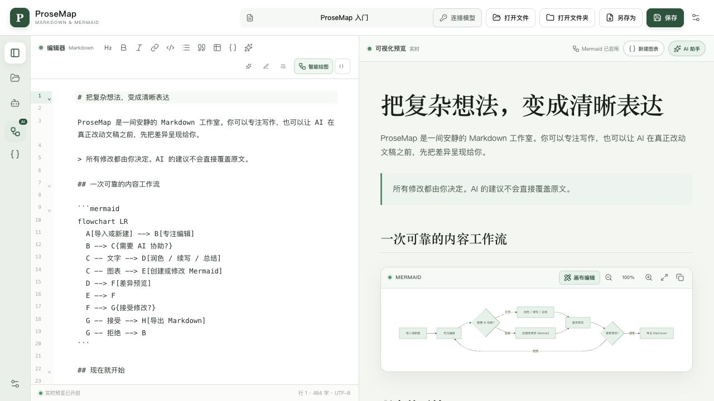
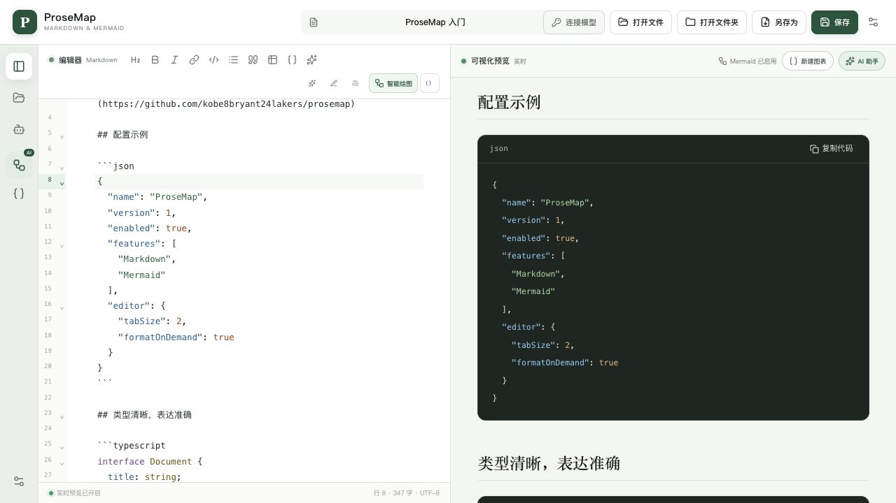
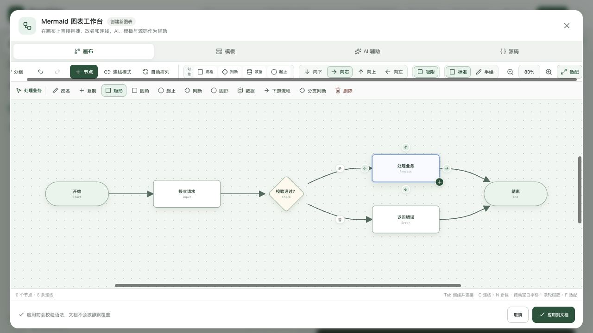

# ProseMap

> Write in flow. See the structure.

ProseMap is a local-first AI Markdown and Mermaid editor for macOS and Windows. It combines focused writing, live visual preview, native file and folder workflows, and reviewable AI-assisted edits in a single desktop application.

The application starts in English and supports instant switching to Simplified Chinese. Your language choice is saved locally; documents and diagram drafts keep their original content.

## In pictures

### Focused writing with live preview

Write Markdown beside the rendered document, including tables, links, and locally rendered Mermaid diagrams.



### Readable code, in source and preview

Language-aware syntax highlighting distinguishes properties, strings, numbers, and keywords. Format the current code block with one action and copy rendered code without selecting it manually.



### A visual Mermaid workbench

Select, rename, connect, and arrange diagram nodes directly on the canvas, with templates and source editing close at hand.



Screenshots show the actual production frontend with sample documents. Native file operations and external-link opening are provided by the desktop shell.

## Highlights

- Save multiple named model connections and switch from the header, writing assistant, or Mermaid AI panel. Each profile keeps its own provider, endpoint, model, and API key; the last selection is restored on restart. Existing single-model credentials migrate automatically when saved.
- Open individual Markdown files or browse every Markdown document in a local folder.
- Edit Markdown in editor-only, preview-only, or side-by-side views using the persistent view controls.
- Open **Outline / 大纲** to navigate headings in any view. Collapse individual sections or the whole panel; the panel preference is saved locally. The outline and file browser share the left sidebar.
- Preview relative local images resolved against the saved Markdown document, including parent directories, Unicode names, and URL-encoded paths.
- Open relative links to local spreadsheets, documents, images, and media in the system's default application directly from the preview.
- Paste screenshots or copied local images into the editor; the desktop app saves them in a sibling `images` folder and inserts relative Markdown references.
- Highlight common fenced-code languages in both the editor and preview; copy code directly from each preview block.
- Edit code with two-space indentation, Tab / Shift+Tab, bracket matching and completion, and folding.
- Format the current code block with Prettier and undo the change in one step.
- Open HTTP/HTTPS links in the system browser, mail links in the default mail application, and heading anchors inside the preview.
- Render Mermaid diagrams locally in strict security mode, including node descriptions and branch labels.
- Create diagrams from natural-language instructions, edit Mermaid source, or directly manipulate flowcharts, sequence diagrams, state diagrams, class diagrams, ER models, mind maps, and Gantt plans on a canvas.
- Start from common templates including basic flowcharts, 4+1 architecture views, sequence diagrams, state diagrams, class diagrams, ER diagrams, Gantt charts, mind maps, use cases, and package structures.
- Edit use cases and nested packages using standard Mermaid flowcharts: actors, system boundaries, include/extend relationships, package membership, and module dependencies are preserved when switching between source and canvas.
- Scroll the document normally over inline diagrams, or open a scrollbar-free fullscreen view with a readable minimum zoom. Use **Overview / 一屏总览** to see the complete diagram with smaller labels, then click the percentage or zoom in to return to the readable view.
- Insert new diagrams at the editor caret captured before opening the workbench.
- Keep diagrams with ordinary Mermaid comments visually editable. Sequence diagrams also accept Unicode participant identifiers, activation markers, notes, boxes, loops, alternatives, and parallel/optional/critical blocks without discarding their structure.
- In structured sequence diagrams, edit participants and messages on the canvas; control statements remain preserved in source order and are inspected from the canvas. Change the control structure in the source tab; newly added messages are appended after existing statements.
- Import class/ER directions and Unicode identifiers, separate class member declarations, standalone states and state descriptions, and plain-text mind map roots into the canvas. Isolated states survive document updates.
- Use AI on the full document or a selection for polishing, continuation, summarization, and custom transformations.
- Custom instructions apply validated local edits while preserving unmentioned source text. Incomplete responses and ambiguous or overlapping edits cannot be accepted.
- Attach up to 12 explicitly selected UTF-8 reference, configuration, and source-code files so text and Mermaid AI edits can use project context beyond the active document.
- Choose a local repository or reference folder, search its file paths, and select project files shared by the writing assistant and Mermaid workbench. Selected project files are read again before every generation.
- Continue a conversation while creating or editing Markdown and diagrams. Review earlier outputs, keep refining an unapplied suggestion, or start a new conversation while keeping the current document.
- Review streamed AI output as a line-by-line diff before accepting or rejecting it.
- Connect to OpenAI-compatible Chat Completions endpoints or Anthropic Claude Messages endpoints.
- Save safely back to the original file or export with Save As.

## Project context and conversations

In the writing assistant or the Mermaid workbench's **AI assist** tab, choose **Choose repository or folder / 选择代码仓或文件夹**. Select a local clone or reference directory, search file paths, and check the files to include. Selecting a folder lists candidate files; only the checked files are read into model requests. Use the refresh button after adding or removing files. This folder selection is shared by both assistants for the current document.

Ask for a new document, a rewrite, an architecture view, or another supported Mermaid diagram, then keep adding instructions. Markdown suggestions open in the diff preview; **Continue conversation / 继续对话** keeps the proposal in history without applying it. Accepted and rejected suggestions are marked accordingly, and the next request includes the current editor content. Mermaid conversations use the latest workbench draft, including manual changes. **New conversation / 新对话** clears both history and its compressed summary, keeping the current content and selected references.

The initial implementation has explicit limits:

- Supports local folders and locally cloned repositories. Remote repository cloning, automatic repository exploration, content indexing, and shell execution are not included; choose reference files explicitly.
- Lists up to 2,000 supported files, visits up to 20,000 entries, and scans up to 12 directory levels. An incomplete scan is identified in the UI. Hidden files, common generated/dependency directories, credential-like filenames, symbolic links, and files excluded by nested `.gitignore` rules are skipped. These filters do not inspect source code for embedded secrets; check your selections before sending them.
- Accepts up to 12 files across attachments and folder selections, at most 2 MB per file, using UTF-8 text. Reference content is capped at 80,000 characters and reduced further when needed to fit the full request. Truncation is shown with the generated proposal or diagram.
- Sends selected content to the configured model service when generating. Reference files are read-only. Folder reads recheck authorization, ignore rules, file types, and size before each request.
- Keeps conversation history and its compressed summary in memory for the current document or open diagram workbench. Requests fit at most 6 history pairs and 20,000 history characters, reduced further for long inputs. Before a request would exceed that budget, the current model automatically summarizes older turns, carrying forward any previous summary and retaining up to 3 recent complete turns as space permits. A summary occupies one history pair and is limited to 4,000 characters. Goals, continuing constraints, confirmed decisions, rejected alternatives, application status, and pending work are requested explicitly; the latest document and instructions remain authoritative. The expandable summary and its covered-turn count are visible in the conversation panel.
- Compression makes additional requests to the selected model and can add latency and provider charges. Large historical exchanges are processed in bounded batches, with up to 12 requests per compression operation. If compression fails, returns an empty/oversized summary, is cancelled, or becomes stale, no partial summary replaces the source history and the pending edit does not run. Retry or start a new conversation; history is never silently evicted to bypass a compression failure. After successful compression, summarized raw turns are replaced by the summary. Summaries may lose details; this is conversation-memory compression, not repository indexing or automatic compression of reference files.
- Failed, cancelled, and stale edits are excluded from history. Changing documents clears references, history, and summary; closing the diagram workbench ends its conversation. Restart recovery is not included.

Automated checks use synthetic repositories and model responses. They validate request construction, file boundaries, conversation state, and editing behavior; they do not establish real-model output quality or native Windows/Linux acceptance.

## Code editing

The Markdown toolbar preserves the current selection. Bold, italic, inline code, headings, lists, quotes and task lists toggle their markers; line actions support multiline selections. Use `Cmd/Ctrl+B`, `Cmd/Ctrl+I`, and `Cmd/Ctrl+K` for inline formatting, or `Cmd/Ctrl+F` for find and replace.

Add a language after the opening fence, such as `json`, `jsonc`, `javascript`, `typescript`, `python`, `sql`, or `yaml`. Highlighting grammars are loaded locally on demand; unknown languages remain readable as plain text.

| Action | Shortcut / control |
| --- | --- |
| Format the current code block | `Cmd+Shift+F` on macOS / `Ctrl+Shift+F` on Windows, or the format button in the editor toolbar |
| Indent / outdent | `Tab` / `Shift+Tab` |
| Leave Tab indentation mode | Press `Esc`, then `Tab` to move keyboard focus |
| Undo formatting | `Cmd+Z` / `Ctrl+Z` |
| Fold a code block | Click the fold marker beside its opening fence |
| Copy preview code | Click the copy button in the code block header |

Formatting supports JSON, JSONC, JSON5, JavaScript/JSX, TypeScript/TSX, CSS/SCSS/Less, HTML/Vue, YAML, and GraphQL. Place the caret in a language-labelled, top-level fenced block. Formatting is explicit and affects only that block; invalid syntax, unsupported languages, and edits made while formatting is loading leave the document unchanged. List- and quote-nested blocks retain highlighting but are not automatically formatted. JSON formatting preserves large numeric literals and duplicate keys.

Preview heading links use lowercase, punctuation-free IDs with spaces replaced by hyphens (for example, `#hello-world`); Chinese headings are supported. Duplicate headings receive numeric suffixes.

## Local attachments and pasted images

In the desktop app, link to files relative to the saved Markdown document and click the link in the preview to open it in the system's default application. For example, `[表格](./附件/report.xlsx)` opens `附件/report.xlsx` beside the Markdown file. Parent directories (`../`), Unicode names, and URL-encoded spaces are supported. Common spreadsheet, document, image, archive, and media formats are supported; executable and script file types are rejected. Missing files and unavailable default applications produce an error message.

Local attachment links with spaces, such as `[表格](./附件/测试 报表.xlsx)`, are also recognized in ProseMap. For compatibility with other Markdown editors, use `[表格](<./附件/测试 报表.xlsx>)` or encode spaces as `%20`. Windows-style relative separators are supported in previews on every desktop platform. Code examples and explicitly escaped links remain literal text.

Copy a screenshot or local image, place the caret in the editor, and press `Cmd+V` on macOS or `Ctrl+V` on Windows/Linux. Images are saved in the Markdown document's directory under `images/`; the folder is created if needed, and unique filenames prevent overwriting existing images. The editor inserts a relative reference such as `` so the document and image folder can be moved together.

If the document has not been saved, pasting an image first opens the Markdown save dialog. Cancelling leaves the document unchanged and does not save the image. Each paste accepts up to 10 images, each no larger than 20 MB, in PNG, JPEG, GIF, WebP, BMP, or AVIF format. Undo removes the inserted references in one step; image files remain in `images/` so redo can restore them.

## Canvas controls

For flowcharts, class diagrams and ER diagrams, drag a selection rectangle on empty canvas, or Shift/Cmd/Ctrl-click nodes to select multiple objects. Move, duplicate or delete the selection together; use the contextual toolbar to align or distribute it. Other diagram types retain their specialized individual editing behavior.

| Action | Control |
| --- | --- |
| Selection / hand tool | `V` / `H` |
| Pan | Wheel, hand tool drag, Space+drag, or middle-button drag |
| Horizontal pan | Shift+wheel |
| Zoom | Cmd/Ctrl+wheel or zoom buttons |
| Fit all / selected objects | `F` / `Shift+F`, or Fit / Selection buttons |
| Create and connect to the right | `Tab` with a node selected |
| Temporarily bypass snapping | Hold `Alt` while dragging or resizing |
| Select all nodes | Cmd/Ctrl+A while canvas has focus |
| Nudge selection | Arrow keys; Shift moves 10 pixels |
| Duplicate selection | Cmd/Ctrl+D |
| Rename | Double-click or Enter; Enter commits, Escape cancels |
| Undo / redo | Cmd/Ctrl+Z / Cmd/Ctrl+Shift+Z |

Dragging, alignment and a continuous rename each undo as one action. Escape cancels an active drag, resize or rename without replacing the existing redo history. New objects and copies find nearby free space; dragging toward the right or bottom expands the canvas, and dragging near the viewport edge scrolls it. Unsupported connections explain the diagram's relationship rule.

Canvas selection and inspector changes preserve the current zoom and pointer location. Switching tabs or temporarily entering invalid source retains the canvas session; returning with changed, valid source preserves existing node positions and starts a new canvas undo history. Manual positions belong to the current canvas session; reopening Mermaid source and rendered previews still use automatic layout. Toolbars wrap to keep actions visible in smaller windows.

## Desktop support

| Platform | Status |
| --- | --- |
| macOS 11+ on Apple silicon | Built and locally verified |
| Windows 10/11 x64 | NSIS and MSI packages share one compatible build; WebView2 bootstrapper configuration is included |
| Linux x64 | Debian and AppImage preview packages built on Ubuntu 22.04; native Linux runtime acceptance pending |
| macOS on Intel | Included in universal macOS preview packages; native Intel runtime acceptance pending |
| iOS and Android | Tauri library entry point reserved for future work; not implemented or verified |

## Local development

### Prerequisites

- Node.js 22.13 or newer
- Rust stable
- macOS: Xcode Command Line Tools
- Windows: Rust MSVC toolchain, Visual Studio C++ Build Tools, Windows SDK, and WebView2
- Linux: WebKitGTK 4.1, GTK 3, OpenSSL and D-Bus development libraries; see [Linux packaging](docs/linux-desktop.md).

Install dependencies and start the desktop application:

```bash
npm ci
npm run desktop:dev
```

`desktop:dev` enables the explicit `dev-credentials` Cargo feature: model settings stay in process memory, never touch your normal credential store, and disappear on exit. The settings dialog identifies this session-only mode.

The Vite development server only binds to `127.0.0.1`. It is an implementation detail of the local Tauri development workflow, not a hosted web product.

## Build

### macOS

Normal builds use the macOS Keychain and require an Apple-issued signing identity (Developer ID Application for distribution). Select an installed identity with `APPLE_SIGNING_IDENTITY`, or let the build select the only available identity:

```bash
npm run macos:signing:check
npm run desktop:build -- --bundles app,dmg
```

Ad-hoc and self-signed builds do not preserve Keychain access across rebuilds on modern macOS. The normal build rejects these signatures and checks the actual Apple certificate chain. CI uses `APPLE_SIGNING_IDENTITY`, `APPLE_CERTIFICATE` and `APPLE_CERTIFICATE_PASSWORD` from repository secrets. Production distribution also requires notarization.

Without an Apple signing identity, use the separate development application:

```bash
npm run desktop:build:dev
```

Open `src-tauri/target/debug/bundle/macos/ProseMap Development.app`. Its model settings stay in memory for the current process and are cleared on quit; it never accesses Keychain. `npm run desktop:dev` uses the same session-only backend. See [macOS signing and Keychain continuity](docs/macos-keychain.md) for verification and migration details.

### Windows

```powershell
npm ci
npm run desktop:build:windows
```

Production distribution requires a Windows code-signing certificate. Windows installers should be built and tested on a real Windows machine or Windows CI runner.

### Linux

Run on a Linux machine with the dependencies listed in [Linux packaging](docs/linux-desktop.md):

```bash
npm ci
npm run desktop:build:linux
```

The **Build Linux desktop packages** GitHub Actions workflow can be run manually to produce `.deb`, `.AppImage` and SHA-256 checksums as test artifacts. Tagged releases call the same workflow and attach successful Linux builds to the existing pre-release. Manual builds do not publish a release.

## Validation

Use [the complex Markdown fixture](docs/fixtures/complex-markdown.md) for manual regression testing. It includes seven diagram types, code, tables, nested lists, image/link boundaries and 80 long-document sections. See [the usability validation report](docs/usability-validation.md) for actual coverage and remaining limits.

See [local attachment and image paste validation](docs/local-attachments-validation.md) for the native desktop checks and platform limits of those features.

See [canvas interaction validation](docs/canvas-interaction-validation.md) for the 11-template operation matrix, 200-node browser checks, geometry benchmark, and remaining native-device validation limits.

```bash
npm run lint
npm run typecheck
npm run test:mermaid
npm run build
node --experimental-strip-types scripts/benchmark-markdown.mjs
cargo fmt --manifest-path src-tauri/Cargo.toml --check
cargo test --manifest-path src-tauri/Cargo.toml
cargo check --manifest-path src-tauri/Cargo.toml --all-targets
```

Pull requests and the main branch run code checks. The full Chromium/WebKit interaction suite runs when the **Repository checks and manual deep acceptance** workflow is started manually. Releases reuse completed validation after reviewing every outgoing commit and its metadata for private information and credentials. Packaging still verifies versions, installer contents, signing requirements, and checksums. Unverified native acceptance cases remain recorded in the release notes.

## Architecture

ProseMap embeds a React interface compiled by Vite inside a Tauri 2 desktop shell. No hosted site, web API route, or remote application UI is required.

The Rust layer exposes a deliberately small native surface:

- User-authorized Markdown file and folder access
- Original-path saving and Save As
- Relative attachment opening and pasted-image storage beside authorized Markdown documents
- Operating-system file association launch targets
- HTTPS model requests, local/private HTTP model requests, and streaming cancellation
- Encrypted, cross-session model configuration in the operating system credential store

Platform-specific configuration lives in:

- `src-tauri/tauri.macos.conf.json`
- `src-tauri/tauri.windows.conf.json`
- `src-tauri/tauri.linux.conf.json`

## AI providers

ProseMap supports:

- OpenAI-compatible Chat Completions endpoints
- Anthropic Claude Messages endpoints

Provider settings and API keys are stored across sessions in the operating system credential store (Windows Credential Manager, macOS Keychain, or Linux Secret Service). Linux needs an available, unlocked Secret Service provider such as GNOME Keyring. They are never written to source files, browser local storage, cookies, or application logs.

AI features require network access to the provider selected by the user. Local editing, file management, Markdown preview, and Mermaid rendering do not require an online application service.

## Security model

- API endpoints may use hostnames, IPv4 addresses, or bracketed IPv6 addresses, with an optional explicit port.
- HTTPS is supported for public and private destinations. Plain HTTP is limited to loopback, private-network, carrier-grade NAT, or link-local destinations and is checked again after hostname resolution.
- HTTPS domain endpoints use the operating system's native TLS backend and trust policy, including administrator-installed enterprise or private roots.
- HTTPS literal-IP endpoints intentionally skip certificate chain and endpoint identity verification. They should be used only on trusted networks because API keys and model content could otherwise be intercepted; ports are not part of certificate identity.
- Credentials in URLs, query strings, fragments, redirects, and unusable network destinations are rejected.
- Validated hostname results are pinned to the outgoing model request to prevent DNS rebinding between validation and connection.
- Upstream errors are size-limited and API keys are redacted.
- Document access is limited to paths explicitly selected by the user or delivered through an operating-system file association. Relative preview images and attachment links are resolved from references in authorized Markdown documents. Images are restricted to supported formats and 20 MB per image; attachment opening is restricted to supported document and media file types. Pasted images are written to a regular `images` directory beside the authorized document.
- AI context files are selected explicitly, read locally, shown in the request UI, and bounded to 80,000 characters before they are sent to the configured model provider.
- Workspace traversal skips symlinks and applies file count, depth, extension, and size limits.
- Saves use a synchronized temporary sibling followed by atomic replacement, protecting the original document from partial writes.
- Markdown preview does not execute raw HTML.
- Mermaid output is rendered in strict mode and sanitized before insertion into the page.
- AI edits are applied only after explicit acceptance in the diff view.

## License

ProseMap is available under the [MIT License](LICENSE).

### Interface language and workspace size

The app starts in English. Use **EN / 中文** in the top bar or **Settings → Interface language** to switch languages. The choice is saved locally and applies immediately; changing the interface language does not translate or replace your document or diagram draft.

In the Mermaid workspace, use **Expand workspace** in the upper-right corner to fill the app window, and **Restore workspace** to return to the dialog. Canvas, templates, AI assist, and source editing all retain the current draft when resizing.
