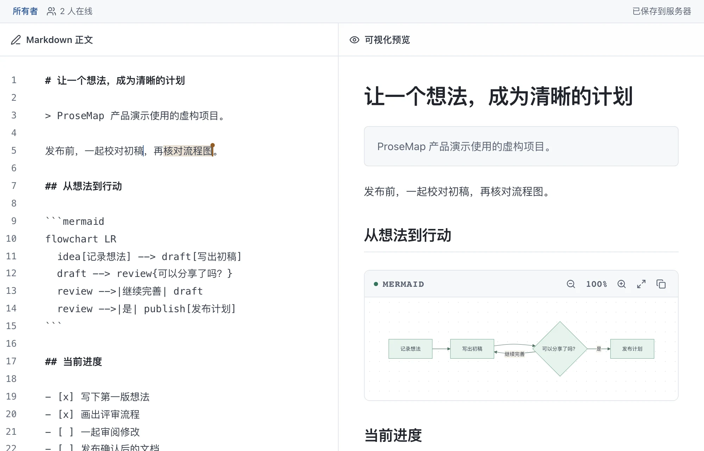
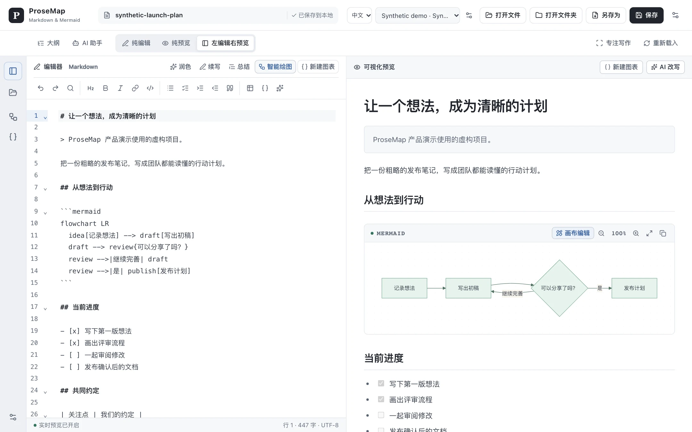
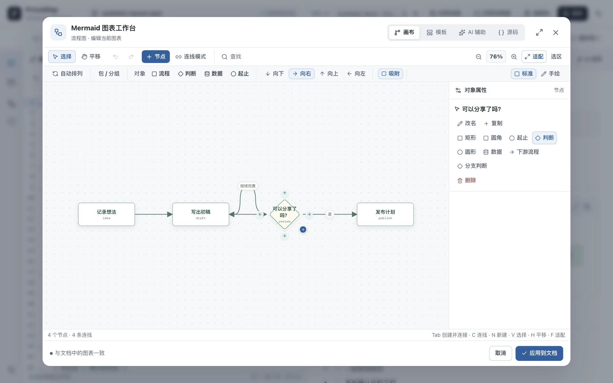
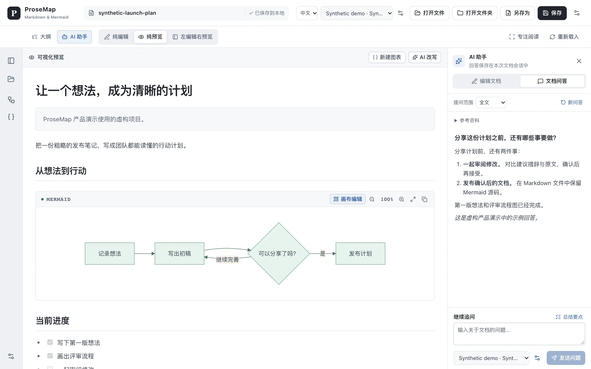
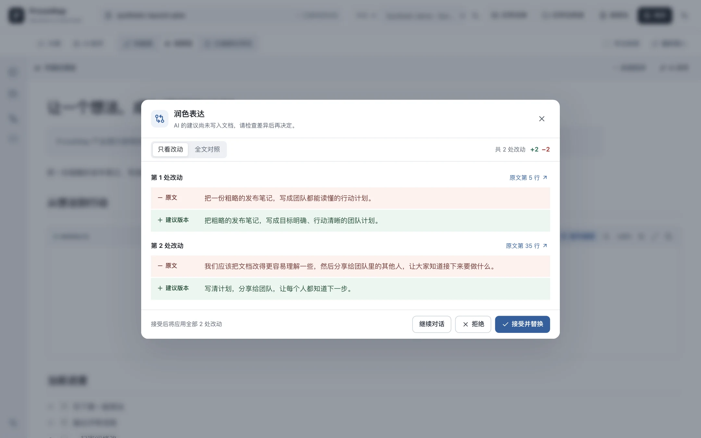

# ProseMap

[English](README.md) | **简体中文**

### 把想法写清楚，把结构画明白。

**本地优先的 Markdown 与 Mermaid 桌面工作区。** 你可以独自写，也可以邀请同事一起改稿，把想法画成可编辑的图，并逐项审阅 AI 的修改建议。

[浏览产品页](https://kobe8bryant24lakers.github.io/prosemap/zh/) · [下载 v0.17.0](https://github.com/kobe8bryant24lakers/prosemap/releases/tag/v0.17.0) · [使用指南（英文）](docs/guide.md)

## 一起写同一段 Markdown

点击 **共享此文档**，在局域网或远程服务器上创建正文副本，发出编辑或只读邀请。同事在自己的 ProseMap 点 **加入**，粘贴链接就能打开这份文档。

两人可以同时改同一段话，看到彼此的光标和实时预览。断线时保持窗口打开，重连后会合并待同步的修改。本地原稿和附件留在各自设备上。[共享写作与服务配置](docs/collaboration.zh-CN.md)。



## 一份文档，让思路自在展开

| 你想做的事 | ProseMap 如何帮你 |
| --- | --- |
| 把想法写下来 | Markdown 实时预览、大纲导航、格式快捷键、代码高亮与代码块格式化。需要安静思考时，切入专注写作或专注阅读。 |
| 把复杂关系讲清楚 | 从模板、源码或 AI 草稿开始画 Mermaid 图。拖动节点、连接关系、查找对象，在属性面板里调整细节。 |
| 读懂一篇长文 | 在**文档问答**中总结全文、解释选中段落，并继续追问。 |
| 改好文章，也保留掌控感 | 在**只看改动**中逐段比较原文与建议，按需打开全文对照，然后接受整份建议、拒绝或继续对话。 |
| 让 AI 理解项目背景 | 从本地文件夹明确选择最多 12 个参考或源码文件，让写作与绘图助手使用同一份参考上下文。 |
| 沿用自己的文件工作流 | 打开 Markdown 文件或文件夹，将粘贴图片保存在文档旁的 `images/` 目录，用系统默认应用打开相对路径附件。 |



## 让结构一眼可见

架构说明写在这里，关系图也画在这里。Mermaid 工作台把**画布、模板、AI 辅助、源码**放在一起，支持流程图、时序图、状态图、类图、ER 图、思维导图与甘特图的可视化编辑。



图表仍是 Markdown 里的 Mermaid 源码。手动布局属于当前画布会话，重新从源码渲染时使用自动布局。详见[画布操作与限制](docs/guide.md#canvas-controls)。

**马上试试：**下载[简短发布计划](website/assets/launch-plan.zh-CN.md)，或打开包含十一种可编辑图表的[巡展交接手册](examples/traveling-exhibition.zh-CN.md)。两者均为学习与演示使用的虚构项目。

## 读到哪里，问到哪里

打开 **AI 助手 → 文档问答**，总结重点、解释段落，或问问下一步该做什么。追问会结合当前文档与本次对话。回答留在当前文档会话中；需要修改时，再切换到**编辑文档**。



## 每一次修改，都由你决定

润色、续写、总结，或给出自己的具体要求。先看流式草稿，完成后再逐段对照。接受会应用整份建议，也可以拒绝，或继续聊到满意为止。



共享写作截图来自 v0.17.0 的两个真实协作会话，使用虚构文档。其他截图来自 v0.16.0 生产前端，文档和模型回答均为虚构示例。截图中的桌面文件操作使用模拟接口，不代表已安装桌面应用的完整验收。

## 从已有的文件开始

1. **安装桌面预览版**，或按指南从源码构建。
2. **打开 Markdown 文件或文件夹。** 试试分栏预览、专注模式和 Mermaid 图表。本地编辑与渲染无需配置 AI。
3. **需要帮手时，再连接模型。** 在设置中添加 OpenAI 兼容 Chat Completions 或 Anthropic Messages 连接，可保存多组配置并随时切换。

| 平台 | v0.17.0 可用方式 |
| --- | --- |
| Windows 10/11 x64 | [EXE 安装包](https://github.com/kobe8bryant24lakers/prosemap/releases/download/v0.17.0/ProseMap-Windows-x64-v0.17.0-setup.exe) · [MSI 安装包](https://github.com/kobe8bryant24lakers/prosemap/releases/download/v0.17.0/ProseMap-Windows-x64-v0.17.0.msi)。当前为未签名预览包。 |
| Linux x64 | [AppImage](https://github.com/kobe8bryant24lakers/prosemap/releases/download/v0.17.0/ProseMap-Linux-x64-v0.17.0.AppImage) · [DEB 安装包](https://github.com/kobe8bryant24lakers/prosemap/releases/download/v0.17.0/ProseMap-Linux-x64-v0.17.0.deb)。原生 Linux 运行验收尚未完成。 |
| macOS | [从源码构建](docs/guide.md#macos)。公开分发的 macOS 安装包需要 Developer ID 签名与公证。 |

应用默认英文，点击 **EN / 中文** 可即时切换简体中文，不会改动文档内容。[版本页面](https://github.com/kobe8bryant24lakers/prosemap/releases/tag/v0.17.0)附有校验文件。移动端尚未实现。

## 文件在本地，模型由你选，修改由你定

- **普通文件，方便带走。** Markdown 与相对图片链接保持可迁移，本地编辑、预览与 Mermaid 渲染可离线使用。
- **按需使用 AI。** 主动调用时，选定文档范围、指令、参考文件和相关对话会发送给你配置的服务商。选择文件夹不会发送整个代码仓。
- **凭据使用系统存储。** 正式构建使用 macOS Keychain、Windows Credential Manager 或 Linux Secret Service；开发构建仅在当前会话内保留凭据。
- **参考上下文明示。** 文件选择有数量与大小限制，发送内容会在界面中体现。筛选器不会识别源码中嵌入的密钥，请检查选中的文件。

模型服务商可能对请求计费，对话压缩也可能产生额外请求。详见 [AI 与项目上下文](docs/guide.md#project-context-and-conversations)以及[安全模型](docs/guide.md#security-model)。

## 当前版本

**[v0.17.0](docs/releases/v0.17.0.md)** 新增 Markdown 多人共编，支持在场光标、编辑或只读邀请，以及断线重连。确认共享后，局域网或远程服务器保存独立的正文副本。

当前为**桌面预览版**。两个 macOS 开发客户端已用合成文档验证双向编辑和保存。Windows、Linux 安装版协作、跨物理网络使用及真实模型输出质量仍待验证。[版本说明](docs/releases/v0.17.0.md)、[原生验收矩阵](docs/v0.11.0-deep-acceptance.md)与[覆盖审计](docs/v0.11.0-acceptance-audit.md)保留了部分完成、工具受限及不支持的案例状态。

## 本地开发

需要 Node.js **22.13+**、Rust stable 以及对应平台的原生构建依赖。

```bash
npm ci
npm run desktop:dev
```

开发应用仅在当前进程内保存模型设置。ProseMap 使用 Tauri 2 承载 React、CodeMirror 与 Mermaid；公开产品页是独立的静态介绍网站。

[开发环境](docs/guide.md#local-development) · [构建说明](docs/guide.md#build) · [验证命令](docs/guide.md#validation) · [GitHub Pages 维护](docs/github-pages.md)

## 许可证

[MIT](LICENSE)。把值得分享的想法，讲清楚。
