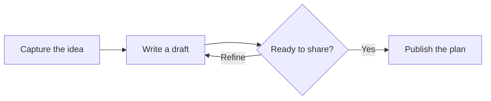

# A small idea, ready to ship

> Synthetic example project for the ProseMap product tour.

Turn a rough release note into a plan the whole team can follow.

## From draft to decision

## The plan

- [x] Write the first draft
- [x] Map the review process
- [ ] Review the changes together
- [ ] Publish the approved document

## What matters

| Decision | Working agreement |
| --- | --- |
| Source of truth | One Markdown document |
| Review | Compare changes before accepting |
| Diagrams | Keep editable Mermaid source |
| Files | Keep the document in our project folder |

## A clearer next step

We should make the document easier to understand and then share it with the team so everyone knows what to do next.

## Release checklist

1. Confirm the scope with the reviewer.
2. Check the diagram against the written plan.
3. Accept only the changes we want to keep.
4. Save the Markdown file beside the project.
