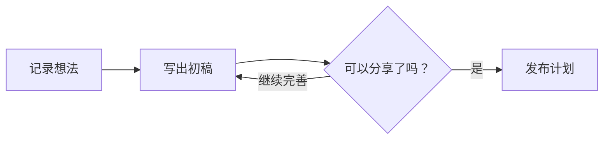

# 让一个想法，成为清晰的计划

> ProseMap 产品演示使用的虚构项目。

把一份粗略的发布笔记，写成团队都能读懂的行动计划。

## 从想法到行动

## 当前进度

- [x] 写下第一版想法
- [x] 画出评审流程
- [ ] 一起审阅修改
- [ ] 发布确认后的文档

## 共同约定

| 关注点 | 我们的约定 |
| --- | --- |
| 文档 | 使用一份 Markdown 文件 |
| 评审 | 比较改动，再决定是否接受 |
| 图表 | 保留可编辑的 Mermaid 源码 |
| 文件 | 放在项目自己的文件夹里 |

## 写清下一步

我们应该把文档改得更容易理解一些，然后分享给团队里的其他人，让大家知道接下来要做什么。

## 发布前检查

1. 和评审者确认本次范围。
2. 检查图表和文字是否一致。
3. 只接受希望保留的修改。
4. 把 Markdown 文件保存到项目旁边。
