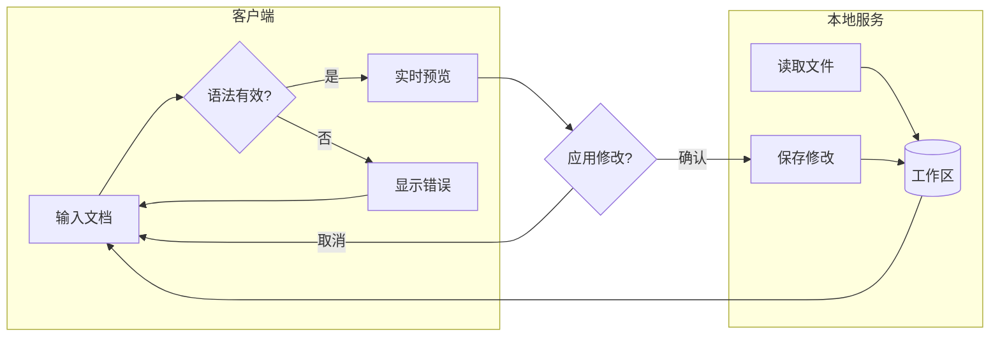
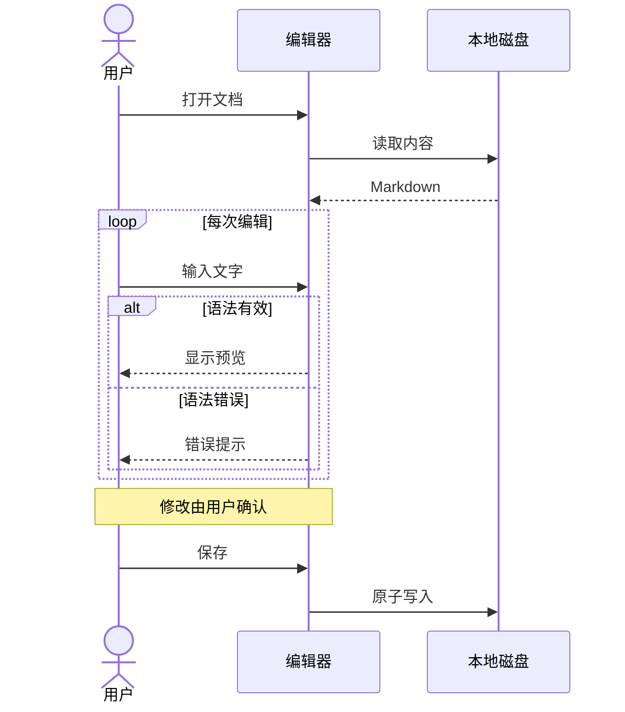
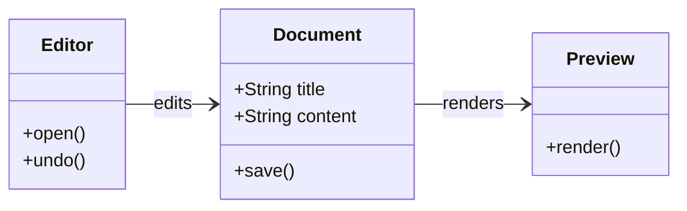
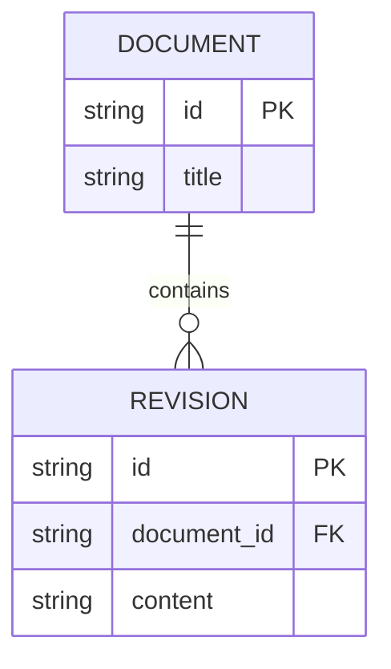
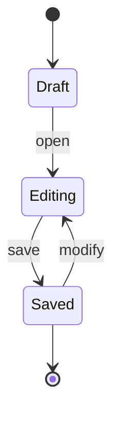
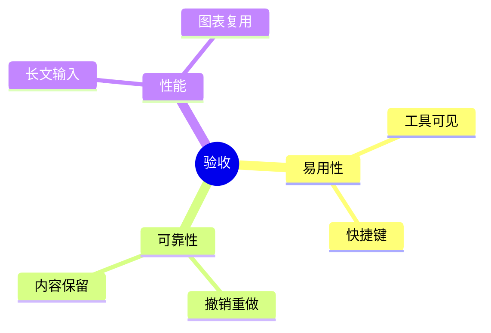
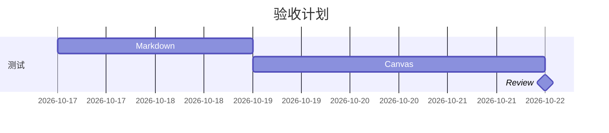

# ProseMap 综合验收文档

这是一份可重复使用的测试文件。验证编辑、预览、画布往返、撤销、长文与边界输入。所有内容均为合成样例。

[跳到验收结尾](#验收结尾) · [draw.io 文档](https://www.drawio.com/docs/) · [中文标题](#中文标题与-emoji)

## 中文标题与 Emoji

中文 English 日本語 🙂 **粗体**、*斜体*、~~删除线~~、`inline code`，以及转义字符 \* \_ \[ \]。

### 同名标题

第一处标题。

### 同名标题

第二处标题，锚点应自动去重。

## 列表与任务

- 项目一
  - 嵌套子项
  - 另一个子项，包含 **强调**
- 项目二

1. 安装与启动
2. 编辑与保存
   1. 验证撤销
   2. 验证重做

- [ ] 检查多行格式化
- [x] 保留原文与 Unicode
- [ ] 检查图表往返

> 多行引用第一行。
> 第二行包含 [页内链接](#验收结尾)。
>
> > 嵌套引用。

## 表格与长单元格

| 功能 | 操作 | 预期 | 状态 |
| :--- | :---: | --- | ---: |
| 格式化 | `⌘/Ctrl+B` | 再按一次取消，不叠加星号 | 待验证 |
| 列表 | 选择两行后点击列表 | 每行一个标记，保留缩进 | 待验证 |
| 画布 | Shift 多选、移动、撤销 | 所有对象一起移动并可恢复 | 待验证 |
| 转义 | A\|B | 单元格内竖线 | 正常 |
| 长字段 | `a_very_long_identifier_that_should_scroll_inside_its_container_without_hiding_toolbar_buttons` | 工具栏仍然可见 | 待验证 |

## 代码块

```json
{"name":"ProseMap","enabled":true,"tags":["中文","English"],"large":9007199254740993,"nested":{"key":"value"}}
```

```typescript
interface Item { id: string; done: boolean }
const items: Item[] = [{ id: '任务-1', done: false }];
export const pending = items.filter(item => !item.done);
```

```python
def summarize(values):
    return {"count": len(values), "sum": sum(values)}
print(summarize([1, 2, 3]))
```

```yaml
workspace:
  name: 综合验收
  features:
    - markdown
    - mermaid
  local: true
```

```sql
SELECT status, COUNT(*) AS total
FROM tasks
GROUP BY status
ORDER BY total DESC;
```

````text
Nested fence demonstration:
```json
{"inside": true}
```
````

## 图片与链接边界


[缺失的标题](#不存在的标题) · [不支持的相对文件链接](./other-document.md)

## 流程图：分支与嵌套分组



## 时序图：结构保留



## 类图



## ER 图



## 状态图



## 思维导图



## 甘特图



## 长文压力区

以下章节用于滚动、查找、替换和输入响应检查。

### 长文章节 01

测试段落包含中文、English、数字 12345 与标点。快速输入时编辑器应优先响应，未修改的图表不应反复闪烁。测试段落包含中文、English、数字 12345 与标点。快速输入时编辑器应优先响应，未修改的图表不应反复闪烁。测试段落包含中文、English、数字 12345 与标点。快速输入时编辑器应优先响应，未修改的图表不应反复闪烁。测试段落包含中文、English、数字 12345 与标点。快速输入时编辑器应优先响应，未修改的图表不应反复闪烁。测试段落包含中文、English、数字 12345 与标点。快速输入时编辑器应优先响应，未修改的图表不应反复闪烁。测试段落包含中文、English、数字 12345 与标点。快速输入时编辑器应优先响应，未修改的图表不应反复闪烁。

- 检查点 01-A：滚动定位
- 检查点 01-B：查找唯一标记 VERIFY-001
- [ ] 检查点 01-C：撤销与重做

### 长文章节 02

测试段落包含中文、English、数字 12345 与标点。快速输入时编辑器应优先响应，未修改的图表不应反复闪烁。测试段落包含中文、English、数字 12345 与标点。快速输入时编辑器应优先响应，未修改的图表不应反复闪烁。测试段落包含中文、English、数字 12345 与标点。快速输入时编辑器应优先响应，未修改的图表不应反复闪烁。测试段落包含中文、English、数字 12345 与标点。快速输入时编辑器应优先响应，未修改的图表不应反复闪烁。测试段落包含中文、English、数字 12345 与标点。快速输入时编辑器应优先响应，未修改的图表不应反复闪烁。测试段落包含中文、English、数字 12345 与标点。快速输入时编辑器应优先响应，未修改的图表不应反复闪烁。

- 检查点 02-A：滚动定位
- 检查点 02-B：查找唯一标记 VERIFY-002
- [ ] 检查点 02-C：撤销与重做

### 长文章节 03

测试段落包含中文、English、数字 12345 与标点。快速输入时编辑器应优先响应，未修改的图表不应反复闪烁。测试段落包含中文、English、数字 12345 与标点。快速输入时编辑器应优先响应，未修改的图表不应反复闪烁。测试段落包含中文、English、数字 12345 与标点。快速输入时编辑器应优先响应，未修改的图表不应反复闪烁。测试段落包含中文、English、数字 12345 与标点。快速输入时编辑器应优先响应，未修改的图表不应反复闪烁。测试段落包含中文、English、数字 12345 与标点。快速输入时编辑器应优先响应，未修改的图表不应反复闪烁。测试段落包含中文、English、数字 12345 与标点。快速输入时编辑器应优先响应，未修改的图表不应反复闪烁。

- 检查点 03-A：滚动定位
- 检查点 03-B：查找唯一标记 VERIFY-003
- [ ] 检查点 03-C：撤销与重做

### 长文章节 04

测试段落包含中文、English、数字 12345 与标点。快速输入时编辑器应优先响应，未修改的图表不应反复闪烁。测试段落包含中文、English、数字 12345 与标点。快速输入时编辑器应优先响应，未修改的图表不应反复闪烁。测试段落包含中文、English、数字 12345 与标点。快速输入时编辑器应优先响应，未修改的图表不应反复闪烁。测试段落包含中文、English、数字 12345 与标点。快速输入时编辑器应优先响应，未修改的图表不应反复闪烁。测试段落包含中文、English、数字 12345 与标点。快速输入时编辑器应优先响应，未修改的图表不应反复闪烁。测试段落包含中文、English、数字 12345 与标点。快速输入时编辑器应优先响应，未修改的图表不应反复闪烁。

- 检查点 04-A：滚动定位
- 检查点 04-B：查找唯一标记 VERIFY-004
- [ ] 检查点 04-C：撤销与重做

### 长文章节 05

测试段落包含中文、English、数字 12345 与标点。快速输入时编辑器应优先响应，未修改的图表不应反复闪烁。测试段落包含中文、English、数字 12345 与标点。快速输入时编辑器应优先响应，未修改的图表不应反复闪烁。测试段落包含中文、English、数字 12345 与标点。快速输入时编辑器应优先响应，未修改的图表不应反复闪烁。测试段落包含中文、English、数字 12345 与标点。快速输入时编辑器应优先响应，未修改的图表不应反复闪烁。测试段落包含中文、English、数字 12345 与标点。快速输入时编辑器应优先响应，未修改的图表不应反复闪烁。测试段落包含中文、English、数字 12345 与标点。快速输入时编辑器应优先响应，未修改的图表不应反复闪烁。

- 检查点 05-A：滚动定位
- 检查点 05-B：查找唯一标记 VERIFY-005
- [ ] 检查点 05-C：撤销与重做

### 长文章节 06

测试段落包含中文、English、数字 12345 与标点。快速输入时编辑器应优先响应，未修改的图表不应反复闪烁。测试段落包含中文、English、数字 12345 与标点。快速输入时编辑器应优先响应，未修改的图表不应反复闪烁。测试段落包含中文、English、数字 12345 与标点。快速输入时编辑器应优先响应，未修改的图表不应反复闪烁。测试段落包含中文、English、数字 12345 与标点。快速输入时编辑器应优先响应，未修改的图表不应反复闪烁。测试段落包含中文、English、数字 12345 与标点。快速输入时编辑器应优先响应，未修改的图表不应反复闪烁。测试段落包含中文、English、数字 12345 与标点。快速输入时编辑器应优先响应，未修改的图表不应反复闪烁。

- 检查点 06-A：滚动定位
- 检查点 06-B：查找唯一标记 VERIFY-006
- [ ] 检查点 06-C：撤销与重做

### 长文章节 07

测试段落包含中文、English、数字 12345 与标点。快速输入时编辑器应优先响应，未修改的图表不应反复闪烁。测试段落包含中文、English、数字 12345 与标点。快速输入时编辑器应优先响应，未修改的图表不应反复闪烁。测试段落包含中文、English、数字 12345 与标点。快速输入时编辑器应优先响应，未修改的图表不应反复闪烁。测试段落包含中文、English、数字 12345 与标点。快速输入时编辑器应优先响应，未修改的图表不应反复闪烁。测试段落包含中文、English、数字 12345 与标点。快速输入时编辑器应优先响应，未修改的图表不应反复闪烁。测试段落包含中文、English、数字 12345 与标点。快速输入时编辑器应优先响应，未修改的图表不应反复闪烁。

- 检查点 07-A：滚动定位
- 检查点 07-B：查找唯一标记 VERIFY-007
- [ ] 检查点 07-C：撤销与重做

### 长文章节 08

测试段落包含中文、English、数字 12345 与标点。快速输入时编辑器应优先响应，未修改的图表不应反复闪烁。测试段落包含中文、English、数字 12345 与标点。快速输入时编辑器应优先响应，未修改的图表不应反复闪烁。测试段落包含中文、English、数字 12345 与标点。快速输入时编辑器应优先响应，未修改的图表不应反复闪烁。测试段落包含中文、English、数字 12345 与标点。快速输入时编辑器应优先响应，未修改的图表不应反复闪烁。测试段落包含中文、English、数字 12345 与标点。快速输入时编辑器应优先响应，未修改的图表不应反复闪烁。测试段落包含中文、English、数字 12345 与标点。快速输入时编辑器应优先响应，未修改的图表不应反复闪烁。

- 检查点 08-A：滚动定位
- 检查点 08-B：查找唯一标记 VERIFY-008
- [ ] 检查点 08-C：撤销与重做

### 长文章节 09

测试段落包含中文、English、数字 12345 与标点。快速输入时编辑器应优先响应，未修改的图表不应反复闪烁。测试段落包含中文、English、数字 12345 与标点。快速输入时编辑器应优先响应，未修改的图表不应反复闪烁。测试段落包含中文、English、数字 12345 与标点。快速输入时编辑器应优先响应，未修改的图表不应反复闪烁。测试段落包含中文、English、数字 12345 与标点。快速输入时编辑器应优先响应，未修改的图表不应反复闪烁。测试段落包含中文、English、数字 12345 与标点。快速输入时编辑器应优先响应，未修改的图表不应反复闪烁。测试段落包含中文、English、数字 12345 与标点。快速输入时编辑器应优先响应，未修改的图表不应反复闪烁。

- 检查点 09-A：滚动定位
- 检查点 09-B：查找唯一标记 VERIFY-009
- [ ] 检查点 09-C：撤销与重做

### 长文章节 10

测试段落包含中文、English、数字 12345 与标点。快速输入时编辑器应优先响应，未修改的图表不应反复闪烁。测试段落包含中文、English、数字 12345 与标点。快速输入时编辑器应优先响应，未修改的图表不应反复闪烁。测试段落包含中文、English、数字 12345 与标点。快速输入时编辑器应优先响应，未修改的图表不应反复闪烁。测试段落包含中文、English、数字 12345 与标点。快速输入时编辑器应优先响应，未修改的图表不应反复闪烁。测试段落包含中文、English、数字 12345 与标点。快速输入时编辑器应优先响应，未修改的图表不应反复闪烁。测试段落包含中文、English、数字 12345 与标点。快速输入时编辑器应优先响应，未修改的图表不应反复闪烁。

- 检查点 10-A：滚动定位
- 检查点 10-B：查找唯一标记 VERIFY-010
- [ ] 检查点 10-C：撤销与重做

### 长文章节 11

测试段落包含中文、English、数字 12345 与标点。快速输入时编辑器应优先响应，未修改的图表不应反复闪烁。测试段落包含中文、English、数字 12345 与标点。快速输入时编辑器应优先响应，未修改的图表不应反复闪烁。测试段落包含中文、English、数字 12345 与标点。快速输入时编辑器应优先响应，未修改的图表不应反复闪烁。测试段落包含中文、English、数字 12345 与标点。快速输入时编辑器应优先响应，未修改的图表不应反复闪烁。测试段落包含中文、English、数字 12345 与标点。快速输入时编辑器应优先响应，未修改的图表不应反复闪烁。测试段落包含中文、English、数字 12345 与标点。快速输入时编辑器应优先响应，未修改的图表不应反复闪烁。

- 检查点 11-A：滚动定位
- 检查点 11-B：查找唯一标记 VERIFY-011
- [ ] 检查点 11-C：撤销与重做

### 长文章节 12

测试段落包含中文、English、数字 12345 与标点。快速输入时编辑器应优先响应，未修改的图表不应反复闪烁。测试段落包含中文、English、数字 12345 与标点。快速输入时编辑器应优先响应，未修改的图表不应反复闪烁。测试段落包含中文、English、数字 12345 与标点。快速输入时编辑器应优先响应，未修改的图表不应反复闪烁。测试段落包含中文、English、数字 12345 与标点。快速输入时编辑器应优先响应，未修改的图表不应反复闪烁。测试段落包含中文、English、数字 12345 与标点。快速输入时编辑器应优先响应，未修改的图表不应反复闪烁。测试段落包含中文、English、数字 12345 与标点。快速输入时编辑器应优先响应，未修改的图表不应反复闪烁。

- 检查点 12-A：滚动定位
- 检查点 12-B：查找唯一标记 VERIFY-012
- [ ] 检查点 12-C：撤销与重做

### 长文章节 13

测试段落包含中文、English、数字 12345 与标点。快速输入时编辑器应优先响应，未修改的图表不应反复闪烁。测试段落包含中文、English、数字 12345 与标点。快速输入时编辑器应优先响应，未修改的图表不应反复闪烁。测试段落包含中文、English、数字 12345 与标点。快速输入时编辑器应优先响应，未修改的图表不应反复闪烁。测试段落包含中文、English、数字 12345 与标点。快速输入时编辑器应优先响应，未修改的图表不应反复闪烁。测试段落包含中文、English、数字 12345 与标点。快速输入时编辑器应优先响应，未修改的图表不应反复闪烁。测试段落包含中文、English、数字 12345 与标点。快速输入时编辑器应优先响应，未修改的图表不应反复闪烁。

- 检查点 13-A：滚动定位
- 检查点 13-B：查找唯一标记 VERIFY-013
- [ ] 检查点 13-C：撤销与重做

### 长文章节 14

测试段落包含中文、English、数字 12345 与标点。快速输入时编辑器应优先响应，未修改的图表不应反复闪烁。测试段落包含中文、English、数字 12345 与标点。快速输入时编辑器应优先响应，未修改的图表不应反复闪烁。测试段落包含中文、English、数字 12345 与标点。快速输入时编辑器应优先响应，未修改的图表不应反复闪烁。测试段落包含中文、English、数字 12345 与标点。快速输入时编辑器应优先响应，未修改的图表不应反复闪烁。测试段落包含中文、English、数字 12345 与标点。快速输入时编辑器应优先响应，未修改的图表不应反复闪烁。测试段落包含中文、English、数字 12345 与标点。快速输入时编辑器应优先响应，未修改的图表不应反复闪烁。

- 检查点 14-A：滚动定位
- 检查点 14-B：查找唯一标记 VERIFY-014
- [ ] 检查点 14-C：撤销与重做

### 长文章节 15

测试段落包含中文、English、数字 12345 与标点。快速输入时编辑器应优先响应，未修改的图表不应反复闪烁。测试段落包含中文、English、数字 12345 与标点。快速输入时编辑器应优先响应，未修改的图表不应反复闪烁。测试段落包含中文、English、数字 12345 与标点。快速输入时编辑器应优先响应，未修改的图表不应反复闪烁。测试段落包含中文、English、数字 12345 与标点。快速输入时编辑器应优先响应，未修改的图表不应反复闪烁。测试段落包含中文、English、数字 12345 与标点。快速输入时编辑器应优先响应，未修改的图表不应反复闪烁。测试段落包含中文、English、数字 12345 与标点。快速输入时编辑器应优先响应，未修改的图表不应反复闪烁。

- 检查点 15-A：滚动定位
- 检查点 15-B：查找唯一标记 VERIFY-015
- [ ] 检查点 15-C：撤销与重做

### 长文章节 16

测试段落包含中文、English、数字 12345 与标点。快速输入时编辑器应优先响应，未修改的图表不应反复闪烁。测试段落包含中文、English、数字 12345 与标点。快速输入时编辑器应优先响应，未修改的图表不应反复闪烁。测试段落包含中文、English、数字 12345 与标点。快速输入时编辑器应优先响应，未修改的图表不应反复闪烁。测试段落包含中文、English、数字 12345 与标点。快速输入时编辑器应优先响应，未修改的图表不应反复闪烁。测试段落包含中文、English、数字 12345 与标点。快速输入时编辑器应优先响应，未修改的图表不应反复闪烁。测试段落包含中文、English、数字 12345 与标点。快速输入时编辑器应优先响应，未修改的图表不应反复闪烁。

- 检查点 16-A：滚动定位
- 检查点 16-B：查找唯一标记 VERIFY-016
- [ ] 检查点 16-C：撤销与重做

### 长文章节 17

测试段落包含中文、English、数字 12345 与标点。快速输入时编辑器应优先响应，未修改的图表不应反复闪烁。测试段落包含中文、English、数字 12345 与标点。快速输入时编辑器应优先响应，未修改的图表不应反复闪烁。测试段落包含中文、English、数字 12345 与标点。快速输入时编辑器应优先响应，未修改的图表不应反复闪烁。测试段落包含中文、English、数字 12345 与标点。快速输入时编辑器应优先响应，未修改的图表不应反复闪烁。测试段落包含中文、English、数字 12345 与标点。快速输入时编辑器应优先响应，未修改的图表不应反复闪烁。测试段落包含中文、English、数字 12345 与标点。快速输入时编辑器应优先响应，未修改的图表不应反复闪烁。

- 检查点 17-A：滚动定位
- 检查点 17-B：查找唯一标记 VERIFY-017
- [ ] 检查点 17-C：撤销与重做

### 长文章节 18

测试段落包含中文、English、数字 12345 与标点。快速输入时编辑器应优先响应，未修改的图表不应反复闪烁。测试段落包含中文、English、数字 12345 与标点。快速输入时编辑器应优先响应，未修改的图表不应反复闪烁。测试段落包含中文、English、数字 12345 与标点。快速输入时编辑器应优先响应，未修改的图表不应反复闪烁。测试段落包含中文、English、数字 12345 与标点。快速输入时编辑器应优先响应，未修改的图表不应反复闪烁。测试段落包含中文、English、数字 12345 与标点。快速输入时编辑器应优先响应，未修改的图表不应反复闪烁。测试段落包含中文、English、数字 12345 与标点。快速输入时编辑器应优先响应，未修改的图表不应反复闪烁。

- 检查点 18-A：滚动定位
- 检查点 18-B：查找唯一标记 VERIFY-018
- [ ] 检查点 18-C：撤销与重做

### 长文章节 19

测试段落包含中文、English、数字 12345 与标点。快速输入时编辑器应优先响应，未修改的图表不应反复闪烁。测试段落包含中文、English、数字 12345 与标点。快速输入时编辑器应优先响应，未修改的图表不应反复闪烁。测试段落包含中文、English、数字 12345 与标点。快速输入时编辑器应优先响应，未修改的图表不应反复闪烁。测试段落包含中文、English、数字 12345 与标点。快速输入时编辑器应优先响应，未修改的图表不应反复闪烁。测试段落包含中文、English、数字 12345 与标点。快速输入时编辑器应优先响应，未修改的图表不应反复闪烁。测试段落包含中文、English、数字 12345 与标点。快速输入时编辑器应优先响应，未修改的图表不应反复闪烁。

- 检查点 19-A：滚动定位
- 检查点 19-B：查找唯一标记 VERIFY-019
- [ ] 检查点 19-C：撤销与重做

### 长文章节 20

测试段落包含中文、English、数字 12345 与标点。快速输入时编辑器应优先响应，未修改的图表不应反复闪烁。测试段落包含中文、English、数字 12345 与标点。快速输入时编辑器应优先响应，未修改的图表不应反复闪烁。测试段落包含中文、English、数字 12345 与标点。快速输入时编辑器应优先响应，未修改的图表不应反复闪烁。测试段落包含中文、English、数字 12345 与标点。快速输入时编辑器应优先响应，未修改的图表不应反复闪烁。测试段落包含中文、English、数字 12345 与标点。快速输入时编辑器应优先响应，未修改的图表不应反复闪烁。测试段落包含中文、English、数字 12345 与标点。快速输入时编辑器应优先响应，未修改的图表不应反复闪烁。

- 检查点 20-A：滚动定位
- 检查点 20-B：查找唯一标记 VERIFY-020
- [ ] 检查点 20-C：撤销与重做

### 长文章节 21

测试段落包含中文、English、数字 12345 与标点。快速输入时编辑器应优先响应，未修改的图表不应反复闪烁。测试段落包含中文、English、数字 12345 与标点。快速输入时编辑器应优先响应，未修改的图表不应反复闪烁。测试段落包含中文、English、数字 12345 与标点。快速输入时编辑器应优先响应，未修改的图表不应反复闪烁。测试段落包含中文、English、数字 12345 与标点。快速输入时编辑器应优先响应，未修改的图表不应反复闪烁。测试段落包含中文、English、数字 12345 与标点。快速输入时编辑器应优先响应，未修改的图表不应反复闪烁。测试段落包含中文、English、数字 12345 与标点。快速输入时编辑器应优先响应，未修改的图表不应反复闪烁。

- 检查点 21-A：滚动定位
- 检查点 21-B：查找唯一标记 VERIFY-021
- [ ] 检查点 21-C：撤销与重做

### 长文章节 22

测试段落包含中文、English、数字 12345 与标点。快速输入时编辑器应优先响应，未修改的图表不应反复闪烁。测试段落包含中文、English、数字 12345 与标点。快速输入时编辑器应优先响应，未修改的图表不应反复闪烁。测试段落包含中文、English、数字 12345 与标点。快速输入时编辑器应优先响应，未修改的图表不应反复闪烁。测试段落包含中文、English、数字 12345 与标点。快速输入时编辑器应优先响应，未修改的图表不应反复闪烁。测试段落包含中文、English、数字 12345 与标点。快速输入时编辑器应优先响应，未修改的图表不应反复闪烁。测试段落包含中文、English、数字 12345 与标点。快速输入时编辑器应优先响应，未修改的图表不应反复闪烁。

- 检查点 22-A：滚动定位
- 检查点 22-B：查找唯一标记 VERIFY-022
- [ ] 检查点 22-C：撤销与重做

### 长文章节 23

测试段落包含中文、English、数字 12345 与标点。快速输入时编辑器应优先响应，未修改的图表不应反复闪烁。测试段落包含中文、English、数字 12345 与标点。快速输入时编辑器应优先响应，未修改的图表不应反复闪烁。测试段落包含中文、English、数字 12345 与标点。快速输入时编辑器应优先响应，未修改的图表不应反复闪烁。测试段落包含中文、English、数字 12345 与标点。快速输入时编辑器应优先响应，未修改的图表不应反复闪烁。测试段落包含中文、English、数字 12345 与标点。快速输入时编辑器应优先响应，未修改的图表不应反复闪烁。测试段落包含中文、English、数字 12345 与标点。快速输入时编辑器应优先响应，未修改的图表不应反复闪烁。

- 检查点 23-A：滚动定位
- 检查点 23-B：查找唯一标记 VERIFY-023
- [ ] 检查点 23-C：撤销与重做

### 长文章节 24

测试段落包含中文、English、数字 12345 与标点。快速输入时编辑器应优先响应，未修改的图表不应反复闪烁。测试段落包含中文、English、数字 12345 与标点。快速输入时编辑器应优先响应，未修改的图表不应反复闪烁。测试段落包含中文、English、数字 12345 与标点。快速输入时编辑器应优先响应，未修改的图表不应反复闪烁。测试段落包含中文、English、数字 12345 与标点。快速输入时编辑器应优先响应，未修改的图表不应反复闪烁。测试段落包含中文、English、数字 12345 与标点。快速输入时编辑器应优先响应，未修改的图表不应反复闪烁。测试段落包含中文、English、数字 12345 与标点。快速输入时编辑器应优先响应，未修改的图表不应反复闪烁。

- 检查点 24-A：滚动定位
- 检查点 24-B：查找唯一标记 VERIFY-024
- [ ] 检查点 24-C：撤销与重做

### 长文章节 25

测试段落包含中文、English、数字 12345 与标点。快速输入时编辑器应优先响应，未修改的图表不应反复闪烁。测试段落包含中文、English、数字 12345 与标点。快速输入时编辑器应优先响应，未修改的图表不应反复闪烁。测试段落包含中文、English、数字 12345 与标点。快速输入时编辑器应优先响应，未修改的图表不应反复闪烁。测试段落包含中文、English、数字 12345 与标点。快速输入时编辑器应优先响应，未修改的图表不应反复闪烁。测试段落包含中文、English、数字 12345 与标点。快速输入时编辑器应优先响应，未修改的图表不应反复闪烁。测试段落包含中文、English、数字 12345 与标点。快速输入时编辑器应优先响应，未修改的图表不应反复闪烁。

- 检查点 25-A：滚动定位
- 检查点 25-B：查找唯一标记 VERIFY-025
- [ ] 检查点 25-C：撤销与重做

### 长文章节 26

测试段落包含中文、English、数字 12345 与标点。快速输入时编辑器应优先响应，未修改的图表不应反复闪烁。测试段落包含中文、English、数字 12345 与标点。快速输入时编辑器应优先响应，未修改的图表不应反复闪烁。测试段落包含中文、English、数字 12345 与标点。快速输入时编辑器应优先响应，未修改的图表不应反复闪烁。测试段落包含中文、English、数字 12345 与标点。快速输入时编辑器应优先响应，未修改的图表不应反复闪烁。测试段落包含中文、English、数字 12345 与标点。快速输入时编辑器应优先响应，未修改的图表不应反复闪烁。测试段落包含中文、English、数字 12345 与标点。快速输入时编辑器应优先响应，未修改的图表不应反复闪烁。

- 检查点 26-A：滚动定位
- 检查点 26-B：查找唯一标记 VERIFY-026
- [ ] 检查点 26-C：撤销与重做

### 长文章节 27

测试段落包含中文、English、数字 12345 与标点。快速输入时编辑器应优先响应，未修改的图表不应反复闪烁。测试段落包含中文、English、数字 12345 与标点。快速输入时编辑器应优先响应，未修改的图表不应反复闪烁。测试段落包含中文、English、数字 12345 与标点。快速输入时编辑器应优先响应，未修改的图表不应反复闪烁。测试段落包含中文、English、数字 12345 与标点。快速输入时编辑器应优先响应，未修改的图表不应反复闪烁。测试段落包含中文、English、数字 12345 与标点。快速输入时编辑器应优先响应，未修改的图表不应反复闪烁。测试段落包含中文、English、数字 12345 与标点。快速输入时编辑器应优先响应，未修改的图表不应反复闪烁。

- 检查点 27-A：滚动定位
- 检查点 27-B：查找唯一标记 VERIFY-027
- [ ] 检查点 27-C：撤销与重做

### 长文章节 28

测试段落包含中文、English、数字 12345 与标点。快速输入时编辑器应优先响应，未修改的图表不应反复闪烁。测试段落包含中文、English、数字 12345 与标点。快速输入时编辑器应优先响应，未修改的图表不应反复闪烁。测试段落包含中文、English、数字 12345 与标点。快速输入时编辑器应优先响应，未修改的图表不应反复闪烁。测试段落包含中文、English、数字 12345 与标点。快速输入时编辑器应优先响应，未修改的图表不应反复闪烁。测试段落包含中文、English、数字 12345 与标点。快速输入时编辑器应优先响应，未修改的图表不应反复闪烁。测试段落包含中文、English、数字 12345 与标点。快速输入时编辑器应优先响应，未修改的图表不应反复闪烁。

- 检查点 28-A：滚动定位
- 检查点 28-B：查找唯一标记 VERIFY-028
- [ ] 检查点 28-C：撤销与重做

### 长文章节 29

测试段落包含中文、English、数字 12345 与标点。快速输入时编辑器应优先响应，未修改的图表不应反复闪烁。测试段落包含中文、English、数字 12345 与标点。快速输入时编辑器应优先响应，未修改的图表不应反复闪烁。测试段落包含中文、English、数字 12345 与标点。快速输入时编辑器应优先响应，未修改的图表不应反复闪烁。测试段落包含中文、English、数字 12345 与标点。快速输入时编辑器应优先响应，未修改的图表不应反复闪烁。测试段落包含中文、English、数字 12345 与标点。快速输入时编辑器应优先响应，未修改的图表不应反复闪烁。测试段落包含中文、English、数字 12345 与标点。快速输入时编辑器应优先响应，未修改的图表不应反复闪烁。

- 检查点 29-A：滚动定位
- 检查点 29-B：查找唯一标记 VERIFY-029
- [ ] 检查点 29-C：撤销与重做

### 长文章节 30

测试段落包含中文、English、数字 12345 与标点。快速输入时编辑器应优先响应，未修改的图表不应反复闪烁。测试段落包含中文、English、数字 12345 与标点。快速输入时编辑器应优先响应，未修改的图表不应反复闪烁。测试段落包含中文、English、数字 12345 与标点。快速输入时编辑器应优先响应，未修改的图表不应反复闪烁。测试段落包含中文、English、数字 12345 与标点。快速输入时编辑器应优先响应，未修改的图表不应反复闪烁。测试段落包含中文、English、数字 12345 与标点。快速输入时编辑器应优先响应，未修改的图表不应反复闪烁。测试段落包含中文、English、数字 12345 与标点。快速输入时编辑器应优先响应，未修改的图表不应反复闪烁。

- 检查点 30-A：滚动定位
- 检查点 30-B：查找唯一标记 VERIFY-030
- [ ] 检查点 30-C：撤销与重做

### 长文章节 31

测试段落包含中文、English、数字 12345 与标点。快速输入时编辑器应优先响应，未修改的图表不应反复闪烁。测试段落包含中文、English、数字 12345 与标点。快速输入时编辑器应优先响应，未修改的图表不应反复闪烁。测试段落包含中文、English、数字 12345 与标点。快速输入时编辑器应优先响应，未修改的图表不应反复闪烁。测试段落包含中文、English、数字 12345 与标点。快速输入时编辑器应优先响应，未修改的图表不应反复闪烁。测试段落包含中文、English、数字 12345 与标点。快速输入时编辑器应优先响应，未修改的图表不应反复闪烁。测试段落包含中文、English、数字 12345 与标点。快速输入时编辑器应优先响应，未修改的图表不应反复闪烁。

- 检查点 31-A：滚动定位
- 检查点 31-B：查找唯一标记 VERIFY-031
- [ ] 检查点 31-C：撤销与重做

### 长文章节 32

测试段落包含中文、English、数字 12345 与标点。快速输入时编辑器应优先响应，未修改的图表不应反复闪烁。测试段落包含中文、English、数字 12345 与标点。快速输入时编辑器应优先响应，未修改的图表不应反复闪烁。测试段落包含中文、English、数字 12345 与标点。快速输入时编辑器应优先响应，未修改的图表不应反复闪烁。测试段落包含中文、English、数字 12345 与标点。快速输入时编辑器应优先响应，未修改的图表不应反复闪烁。测试段落包含中文、English、数字 12345 与标点。快速输入时编辑器应优先响应，未修改的图表不应反复闪烁。测试段落包含中文、English、数字 12345 与标点。快速输入时编辑器应优先响应，未修改的图表不应反复闪烁。

- 检查点 32-A：滚动定位
- 检查点 32-B：查找唯一标记 VERIFY-032
- [ ] 检查点 32-C：撤销与重做

### 长文章节 33

测试段落包含中文、English、数字 12345 与标点。快速输入时编辑器应优先响应，未修改的图表不应反复闪烁。测试段落包含中文、English、数字 12345 与标点。快速输入时编辑器应优先响应，未修改的图表不应反复闪烁。测试段落包含中文、English、数字 12345 与标点。快速输入时编辑器应优先响应，未修改的图表不应反复闪烁。测试段落包含中文、English、数字 12345 与标点。快速输入时编辑器应优先响应，未修改的图表不应反复闪烁。测试段落包含中文、English、数字 12345 与标点。快速输入时编辑器应优先响应，未修改的图表不应反复闪烁。测试段落包含中文、English、数字 12345 与标点。快速输入时编辑器应优先响应，未修改的图表不应反复闪烁。

- 检查点 33-A：滚动定位
- 检查点 33-B：查找唯一标记 VERIFY-033
- [ ] 检查点 33-C：撤销与重做

### 长文章节 34

测试段落包含中文、English、数字 12345 与标点。快速输入时编辑器应优先响应，未修改的图表不应反复闪烁。测试段落包含中文、English、数字 12345 与标点。快速输入时编辑器应优先响应，未修改的图表不应反复闪烁。测试段落包含中文、English、数字 12345 与标点。快速输入时编辑器应优先响应，未修改的图表不应反复闪烁。测试段落包含中文、English、数字 12345 与标点。快速输入时编辑器应优先响应，未修改的图表不应反复闪烁。测试段落包含中文、English、数字 12345 与标点。快速输入时编辑器应优先响应，未修改的图表不应反复闪烁。测试段落包含中文、English、数字 12345 与标点。快速输入时编辑器应优先响应，未修改的图表不应反复闪烁。

- 检查点 34-A：滚动定位
- 检查点 34-B：查找唯一标记 VERIFY-034
- [ ] 检查点 34-C：撤销与重做

### 长文章节 35

测试段落包含中文、English、数字 12345 与标点。快速输入时编辑器应优先响应，未修改的图表不应反复闪烁。测试段落包含中文、English、数字 12345 与标点。快速输入时编辑器应优先响应，未修改的图表不应反复闪烁。测试段落包含中文、English、数字 12345 与标点。快速输入时编辑器应优先响应，未修改的图表不应反复闪烁。测试段落包含中文、English、数字 12345 与标点。快速输入时编辑器应优先响应，未修改的图表不应反复闪烁。测试段落包含中文、English、数字 12345 与标点。快速输入时编辑器应优先响应，未修改的图表不应反复闪烁。测试段落包含中文、English、数字 12345 与标点。快速输入时编辑器应优先响应，未修改的图表不应反复闪烁。

- 检查点 35-A：滚动定位
- 检查点 35-B：查找唯一标记 VERIFY-035
- [ ] 检查点 35-C：撤销与重做

### 长文章节 36

测试段落包含中文、English、数字 12345 与标点。快速输入时编辑器应优先响应，未修改的图表不应反复闪烁。测试段落包含中文、English、数字 12345 与标点。快速输入时编辑器应优先响应，未修改的图表不应反复闪烁。测试段落包含中文、English、数字 12345 与标点。快速输入时编辑器应优先响应，未修改的图表不应反复闪烁。测试段落包含中文、English、数字 12345 与标点。快速输入时编辑器应优先响应，未修改的图表不应反复闪烁。测试段落包含中文、English、数字 12345 与标点。快速输入时编辑器应优先响应，未修改的图表不应反复闪烁。测试段落包含中文、English、数字 12345 与标点。快速输入时编辑器应优先响应，未修改的图表不应反复闪烁。

- 检查点 36-A：滚动定位
- 检查点 36-B：查找唯一标记 VERIFY-036
- [ ] 检查点 36-C：撤销与重做

### 长文章节 37

测试段落包含中文、English、数字 12345 与标点。快速输入时编辑器应优先响应，未修改的图表不应反复闪烁。测试段落包含中文、English、数字 12345 与标点。快速输入时编辑器应优先响应，未修改的图表不应反复闪烁。测试段落包含中文、English、数字 12345 与标点。快速输入时编辑器应优先响应，未修改的图表不应反复闪烁。测试段落包含中文、English、数字 12345 与标点。快速输入时编辑器应优先响应，未修改的图表不应反复闪烁。测试段落包含中文、English、数字 12345 与标点。快速输入时编辑器应优先响应，未修改的图表不应反复闪烁。测试段落包含中文、English、数字 12345 与标点。快速输入时编辑器应优先响应，未修改的图表不应反复闪烁。

- 检查点 37-A：滚动定位
- 检查点 37-B：查找唯一标记 VERIFY-037
- [ ] 检查点 37-C：撤销与重做

### 长文章节 38

测试段落包含中文、English、数字 12345 与标点。快速输入时编辑器应优先响应，未修改的图表不应反复闪烁。测试段落包含中文、English、数字 12345 与标点。快速输入时编辑器应优先响应，未修改的图表不应反复闪烁。测试段落包含中文、English、数字 12345 与标点。快速输入时编辑器应优先响应，未修改的图表不应反复闪烁。测试段落包含中文、English、数字 12345 与标点。快速输入时编辑器应优先响应，未修改的图表不应反复闪烁。测试段落包含中文、English、数字 12345 与标点。快速输入时编辑器应优先响应，未修改的图表不应反复闪烁。测试段落包含中文、English、数字 12345 与标点。快速输入时编辑器应优先响应，未修改的图表不应反复闪烁。

- 检查点 38-A：滚动定位
- 检查点 38-B：查找唯一标记 VERIFY-038
- [ ] 检查点 38-C：撤销与重做

### 长文章节 39

测试段落包含中文、English、数字 12345 与标点。快速输入时编辑器应优先响应，未修改的图表不应反复闪烁。测试段落包含中文、English、数字 12345 与标点。快速输入时编辑器应优先响应，未修改的图表不应反复闪烁。测试段落包含中文、English、数字 12345 与标点。快速输入时编辑器应优先响应，未修改的图表不应反复闪烁。测试段落包含中文、English、数字 12345 与标点。快速输入时编辑器应优先响应，未修改的图表不应反复闪烁。测试段落包含中文、English、数字 12345 与标点。快速输入时编辑器应优先响应，未修改的图表不应反复闪烁。测试段落包含中文、English、数字 12345 与标点。快速输入时编辑器应优先响应，未修改的图表不应反复闪烁。

- 检查点 39-A：滚动定位
- 检查点 39-B：查找唯一标记 VERIFY-039
- [ ] 检查点 39-C：撤销与重做

### 长文章节 40

测试段落包含中文、English、数字 12345 与标点。快速输入时编辑器应优先响应，未修改的图表不应反复闪烁。测试段落包含中文、English、数字 12345 与标点。快速输入时编辑器应优先响应，未修改的图表不应反复闪烁。测试段落包含中文、English、数字 12345 与标点。快速输入时编辑器应优先响应，未修改的图表不应反复闪烁。测试段落包含中文、English、数字 12345 与标点。快速输入时编辑器应优先响应，未修改的图表不应反复闪烁。测试段落包含中文、English、数字 12345 与标点。快速输入时编辑器应优先响应，未修改的图表不应反复闪烁。测试段落包含中文、English、数字 12345 与标点。快速输入时编辑器应优先响应，未修改的图表不应反复闪烁。

- 检查点 40-A：滚动定位
- 检查点 40-B：查找唯一标记 VERIFY-040
- [ ] 检查点 40-C：撤销与重做

### 长文章节 41

测试段落包含中文、English、数字 12345 与标点。快速输入时编辑器应优先响应，未修改的图表不应反复闪烁。测试段落包含中文、English、数字 12345 与标点。快速输入时编辑器应优先响应，未修改的图表不应反复闪烁。测试段落包含中文、English、数字 12345 与标点。快速输入时编辑器应优先响应，未修改的图表不应反复闪烁。测试段落包含中文、English、数字 12345 与标点。快速输入时编辑器应优先响应，未修改的图表不应反复闪烁。测试段落包含中文、English、数字 12345 与标点。快速输入时编辑器应优先响应，未修改的图表不应反复闪烁。测试段落包含中文、English、数字 12345 与标点。快速输入时编辑器应优先响应，未修改的图表不应反复闪烁。

- 检查点 41-A：滚动定位
- 检查点 41-B：查找唯一标记 VERIFY-041
- [ ] 检查点 41-C：撤销与重做

### 长文章节 42

测试段落包含中文、English、数字 12345 与标点。快速输入时编辑器应优先响应，未修改的图表不应反复闪烁。测试段落包含中文、English、数字 12345 与标点。快速输入时编辑器应优先响应，未修改的图表不应反复闪烁。测试段落包含中文、English、数字 12345 与标点。快速输入时编辑器应优先响应，未修改的图表不应反复闪烁。测试段落包含中文、English、数字 12345 与标点。快速输入时编辑器应优先响应，未修改的图表不应反复闪烁。测试段落包含中文、English、数字 12345 与标点。快速输入时编辑器应优先响应，未修改的图表不应反复闪烁。测试段落包含中文、English、数字 12345 与标点。快速输入时编辑器应优先响应，未修改的图表不应反复闪烁。

- 检查点 42-A：滚动定位
- 检查点 42-B：查找唯一标记 VERIFY-042
- [ ] 检查点 42-C：撤销与重做

### 长文章节 43

测试段落包含中文、English、数字 12345 与标点。快速输入时编辑器应优先响应，未修改的图表不应反复闪烁。测试段落包含中文、English、数字 12345 与标点。快速输入时编辑器应优先响应，未修改的图表不应反复闪烁。测试段落包含中文、English、数字 12345 与标点。快速输入时编辑器应优先响应，未修改的图表不应反复闪烁。测试段落包含中文、English、数字 12345 与标点。快速输入时编辑器应优先响应，未修改的图表不应反复闪烁。测试段落包含中文、English、数字 12345 与标点。快速输入时编辑器应优先响应，未修改的图表不应反复闪烁。测试段落包含中文、English、数字 12345 与标点。快速输入时编辑器应优先响应，未修改的图表不应反复闪烁。

- 检查点 43-A：滚动定位
- 检查点 43-B：查找唯一标记 VERIFY-043
- [ ] 检查点 43-C：撤销与重做

### 长文章节 44

测试段落包含中文、English、数字 12345 与标点。快速输入时编辑器应优先响应，未修改的图表不应反复闪烁。测试段落包含中文、English、数字 12345 与标点。快速输入时编辑器应优先响应，未修改的图表不应反复闪烁。测试段落包含中文、English、数字 12345 与标点。快速输入时编辑器应优先响应，未修改的图表不应反复闪烁。测试段落包含中文、English、数字 12345 与标点。快速输入时编辑器应优先响应，未修改的图表不应反复闪烁。测试段落包含中文、English、数字 12345 与标点。快速输入时编辑器应优先响应，未修改的图表不应反复闪烁。测试段落包含中文、English、数字 12345 与标点。快速输入时编辑器应优先响应，未修改的图表不应反复闪烁。

- 检查点 44-A：滚动定位
- 检查点 44-B：查找唯一标记 VERIFY-044
- [ ] 检查点 44-C：撤销与重做

### 长文章节 45

测试段落包含中文、English、数字 12345 与标点。快速输入时编辑器应优先响应，未修改的图表不应反复闪烁。测试段落包含中文、English、数字 12345 与标点。快速输入时编辑器应优先响应，未修改的图表不应反复闪烁。测试段落包含中文、English、数字 12345 与标点。快速输入时编辑器应优先响应，未修改的图表不应反复闪烁。测试段落包含中文、English、数字 12345 与标点。快速输入时编辑器应优先响应，未修改的图表不应反复闪烁。测试段落包含中文、English、数字 12345 与标点。快速输入时编辑器应优先响应，未修改的图表不应反复闪烁。测试段落包含中文、English、数字 12345 与标点。快速输入时编辑器应优先响应，未修改的图表不应反复闪烁。

- 检查点 45-A：滚动定位
- 检查点 45-B：查找唯一标记 VERIFY-045
- [ ] 检查点 45-C：撤销与重做

### 长文章节 46

测试段落包含中文、English、数字 12345 与标点。快速输入时编辑器应优先响应，未修改的图表不应反复闪烁。测试段落包含中文、English、数字 12345 与标点。快速输入时编辑器应优先响应，未修改的图表不应反复闪烁。测试段落包含中文、English、数字 12345 与标点。快速输入时编辑器应优先响应，未修改的图表不应反复闪烁。测试段落包含中文、English、数字 12345 与标点。快速输入时编辑器应优先响应，未修改的图表不应反复闪烁。测试段落包含中文、English、数字 12345 与标点。快速输入时编辑器应优先响应，未修改的图表不应反复闪烁。测试段落包含中文、English、数字 12345 与标点。快速输入时编辑器应优先响应，未修改的图表不应反复闪烁。

- 检查点 46-A：滚动定位
- 检查点 46-B：查找唯一标记 VERIFY-046
- [ ] 检查点 46-C：撤销与重做

### 长文章节 47

测试段落包含中文、English、数字 12345 与标点。快速输入时编辑器应优先响应，未修改的图表不应反复闪烁。测试段落包含中文、English、数字 12345 与标点。快速输入时编辑器应优先响应，未修改的图表不应反复闪烁。测试段落包含中文、English、数字 12345 与标点。快速输入时编辑器应优先响应，未修改的图表不应反复闪烁。测试段落包含中文、English、数字 12345 与标点。快速输入时编辑器应优先响应，未修改的图表不应反复闪烁。测试段落包含中文、English、数字 12345 与标点。快速输入时编辑器应优先响应，未修改的图表不应反复闪烁。测试段落包含中文、English、数字 12345 与标点。快速输入时编辑器应优先响应，未修改的图表不应反复闪烁。

- 检查点 47-A：滚动定位
- 检查点 47-B：查找唯一标记 VERIFY-047
- [ ] 检查点 47-C：撤销与重做

### 长文章节 48

测试段落包含中文、English、数字 12345 与标点。快速输入时编辑器应优先响应，未修改的图表不应反复闪烁。测试段落包含中文、English、数字 12345 与标点。快速输入时编辑器应优先响应，未修改的图表不应反复闪烁。测试段落包含中文、English、数字 12345 与标点。快速输入时编辑器应优先响应，未修改的图表不应反复闪烁。测试段落包含中文、English、数字 12345 与标点。快速输入时编辑器应优先响应，未修改的图表不应反复闪烁。测试段落包含中文、English、数字 12345 与标点。快速输入时编辑器应优先响应，未修改的图表不应反复闪烁。测试段落包含中文、English、数字 12345 与标点。快速输入时编辑器应优先响应，未修改的图表不应反复闪烁。

- 检查点 48-A：滚动定位
- 检查点 48-B：查找唯一标记 VERIFY-048
- [ ] 检查点 48-C：撤销与重做

### 长文章节 49

测试段落包含中文、English、数字 12345 与标点。快速输入时编辑器应优先响应，未修改的图表不应反复闪烁。测试段落包含中文、English、数字 12345 与标点。快速输入时编辑器应优先响应，未修改的图表不应反复闪烁。测试段落包含中文、English、数字 12345 与标点。快速输入时编辑器应优先响应，未修改的图表不应反复闪烁。测试段落包含中文、English、数字 12345 与标点。快速输入时编辑器应优先响应，未修改的图表不应反复闪烁。测试段落包含中文、English、数字 12345 与标点。快速输入时编辑器应优先响应，未修改的图表不应反复闪烁。测试段落包含中文、English、数字 12345 与标点。快速输入时编辑器应优先响应，未修改的图表不应反复闪烁。

- 检查点 49-A：滚动定位
- 检查点 49-B：查找唯一标记 VERIFY-049
- [ ] 检查点 49-C：撤销与重做

### 长文章节 50

测试段落包含中文、English、数字 12345 与标点。快速输入时编辑器应优先响应，未修改的图表不应反复闪烁。测试段落包含中文、English、数字 12345 与标点。快速输入时编辑器应优先响应，未修改的图表不应反复闪烁。测试段落包含中文、English、数字 12345 与标点。快速输入时编辑器应优先响应，未修改的图表不应反复闪烁。测试段落包含中文、English、数字 12345 与标点。快速输入时编辑器应优先响应，未修改的图表不应反复闪烁。测试段落包含中文、English、数字 12345 与标点。快速输入时编辑器应优先响应，未修改的图表不应反复闪烁。测试段落包含中文、English、数字 12345 与标点。快速输入时编辑器应优先响应，未修改的图表不应反复闪烁。

- 检查点 50-A：滚动定位
- 检查点 50-B：查找唯一标记 VERIFY-050
- [ ] 检查点 50-C：撤销与重做

### 长文章节 51

测试段落包含中文、English、数字 12345 与标点。快速输入时编辑器应优先响应，未修改的图表不应反复闪烁。测试段落包含中文、English、数字 12345 与标点。快速输入时编辑器应优先响应，未修改的图表不应反复闪烁。测试段落包含中文、English、数字 12345 与标点。快速输入时编辑器应优先响应，未修改的图表不应反复闪烁。测试段落包含中文、English、数字 12345 与标点。快速输入时编辑器应优先响应，未修改的图表不应反复闪烁。测试段落包含中文、English、数字 12345 与标点。快速输入时编辑器应优先响应，未修改的图表不应反复闪烁。测试段落包含中文、English、数字 12345 与标点。快速输入时编辑器应优先响应，未修改的图表不应反复闪烁。

- 检查点 51-A：滚动定位
- 检查点 51-B：查找唯一标记 VERIFY-051
- [ ] 检查点 51-C：撤销与重做

### 长文章节 52

测试段落包含中文、English、数字 12345 与标点。快速输入时编辑器应优先响应，未修改的图表不应反复闪烁。测试段落包含中文、English、数字 12345 与标点。快速输入时编辑器应优先响应，未修改的图表不应反复闪烁。测试段落包含中文、English、数字 12345 与标点。快速输入时编辑器应优先响应，未修改的图表不应反复闪烁。测试段落包含中文、English、数字 12345 与标点。快速输入时编辑器应优先响应，未修改的图表不应反复闪烁。测试段落包含中文、English、数字 12345 与标点。快速输入时编辑器应优先响应，未修改的图表不应反复闪烁。测试段落包含中文、English、数字 12345 与标点。快速输入时编辑器应优先响应，未修改的图表不应反复闪烁。

- 检查点 52-A：滚动定位
- 检查点 52-B：查找唯一标记 VERIFY-052
- [ ] 检查点 52-C：撤销与重做

### 长文章节 53

测试段落包含中文、English、数字 12345 与标点。快速输入时编辑器应优先响应，未修改的图表不应反复闪烁。测试段落包含中文、English、数字 12345 与标点。快速输入时编辑器应优先响应，未修改的图表不应反复闪烁。测试段落包含中文、English、数字 12345 与标点。快速输入时编辑器应优先响应，未修改的图表不应反复闪烁。测试段落包含中文、English、数字 12345 与标点。快速输入时编辑器应优先响应，未修改的图表不应反复闪烁。测试段落包含中文、English、数字 12345 与标点。快速输入时编辑器应优先响应，未修改的图表不应反复闪烁。测试段落包含中文、English、数字 12345 与标点。快速输入时编辑器应优先响应，未修改的图表不应反复闪烁。

- 检查点 53-A：滚动定位
- 检查点 53-B：查找唯一标记 VERIFY-053
- [ ] 检查点 53-C：撤销与重做

### 长文章节 54

测试段落包含中文、English、数字 12345 与标点。快速输入时编辑器应优先响应，未修改的图表不应反复闪烁。测试段落包含中文、English、数字 12345 与标点。快速输入时编辑器应优先响应，未修改的图表不应反复闪烁。测试段落包含中文、English、数字 12345 与标点。快速输入时编辑器应优先响应，未修改的图表不应反复闪烁。测试段落包含中文、English、数字 12345 与标点。快速输入时编辑器应优先响应，未修改的图表不应反复闪烁。测试段落包含中文、English、数字 12345 与标点。快速输入时编辑器应优先响应，未修改的图表不应反复闪烁。测试段落包含中文、English、数字 12345 与标点。快速输入时编辑器应优先响应，未修改的图表不应反复闪烁。

- 检查点 54-A：滚动定位
- 检查点 54-B：查找唯一标记 VERIFY-054
- [ ] 检查点 54-C：撤销与重做

### 长文章节 55

测试段落包含中文、English、数字 12345 与标点。快速输入时编辑器应优先响应，未修改的图表不应反复闪烁。测试段落包含中文、English、数字 12345 与标点。快速输入时编辑器应优先响应，未修改的图表不应反复闪烁。测试段落包含中文、English、数字 12345 与标点。快速输入时编辑器应优先响应，未修改的图表不应反复闪烁。测试段落包含中文、English、数字 12345 与标点。快速输入时编辑器应优先响应，未修改的图表不应反复闪烁。测试段落包含中文、English、数字 12345 与标点。快速输入时编辑器应优先响应，未修改的图表不应反复闪烁。测试段落包含中文、English、数字 12345 与标点。快速输入时编辑器应优先响应，未修改的图表不应反复闪烁。

- 检查点 55-A：滚动定位
- 检查点 55-B：查找唯一标记 VERIFY-055
- [ ] 检查点 55-C：撤销与重做

### 长文章节 56

测试段落包含中文、English、数字 12345 与标点。快速输入时编辑器应优先响应，未修改的图表不应反复闪烁。测试段落包含中文、English、数字 12345 与标点。快速输入时编辑器应优先响应，未修改的图表不应反复闪烁。测试段落包含中文、English、数字 12345 与标点。快速输入时编辑器应优先响应，未修改的图表不应反复闪烁。测试段落包含中文、English、数字 12345 与标点。快速输入时编辑器应优先响应，未修改的图表不应反复闪烁。测试段落包含中文、English、数字 12345 与标点。快速输入时编辑器应优先响应，未修改的图表不应反复闪烁。测试段落包含中文、English、数字 12345 与标点。快速输入时编辑器应优先响应，未修改的图表不应反复闪烁。

- 检查点 56-A：滚动定位
- 检查点 56-B：查找唯一标记 VERIFY-056
- [ ] 检查点 56-C：撤销与重做

### 长文章节 57

测试段落包含中文、English、数字 12345 与标点。快速输入时编辑器应优先响应，未修改的图表不应反复闪烁。测试段落包含中文、English、数字 12345 与标点。快速输入时编辑器应优先响应，未修改的图表不应反复闪烁。测试段落包含中文、English、数字 12345 与标点。快速输入时编辑器应优先响应，未修改的图表不应反复闪烁。测试段落包含中文、English、数字 12345 与标点。快速输入时编辑器应优先响应，未修改的图表不应反复闪烁。测试段落包含中文、English、数字 12345 与标点。快速输入时编辑器应优先响应，未修改的图表不应反复闪烁。测试段落包含中文、English、数字 12345 与标点。快速输入时编辑器应优先响应，未修改的图表不应反复闪烁。

- 检查点 57-A：滚动定位
- 检查点 57-B：查找唯一标记 VERIFY-057
- [ ] 检查点 57-C：撤销与重做

### 长文章节 58

测试段落包含中文、English、数字 12345 与标点。快速输入时编辑器应优先响应，未修改的图表不应反复闪烁。测试段落包含中文、English、数字 12345 与标点。快速输入时编辑器应优先响应，未修改的图表不应反复闪烁。测试段落包含中文、English、数字 12345 与标点。快速输入时编辑器应优先响应，未修改的图表不应反复闪烁。测试段落包含中文、English、数字 12345 与标点。快速输入时编辑器应优先响应，未修改的图表不应反复闪烁。测试段落包含中文、English、数字 12345 与标点。快速输入时编辑器应优先响应，未修改的图表不应反复闪烁。测试段落包含中文、English、数字 12345 与标点。快速输入时编辑器应优先响应，未修改的图表不应反复闪烁。

- 检查点 58-A：滚动定位
- 检查点 58-B：查找唯一标记 VERIFY-058
- [ ] 检查点 58-C：撤销与重做

### 长文章节 59

测试段落包含中文、English、数字 12345 与标点。快速输入时编辑器应优先响应，未修改的图表不应反复闪烁。测试段落包含中文、English、数字 12345 与标点。快速输入时编辑器应优先响应，未修改的图表不应反复闪烁。测试段落包含中文、English、数字 12345 与标点。快速输入时编辑器应优先响应，未修改的图表不应反复闪烁。测试段落包含中文、English、数字 12345 与标点。快速输入时编辑器应优先响应，未修改的图表不应反复闪烁。测试段落包含中文、English、数字 12345 与标点。快速输入时编辑器应优先响应，未修改的图表不应反复闪烁。测试段落包含中文、English、数字 12345 与标点。快速输入时编辑器应优先响应，未修改的图表不应反复闪烁。

- 检查点 59-A：滚动定位
- 检查点 59-B：查找唯一标记 VERIFY-059
- [ ] 检查点 59-C：撤销与重做

### 长文章节 60

测试段落包含中文、English、数字 12345 与标点。快速输入时编辑器应优先响应，未修改的图表不应反复闪烁。测试段落包含中文、English、数字 12345 与标点。快速输入时编辑器应优先响应，未修改的图表不应反复闪烁。测试段落包含中文、English、数字 12345 与标点。快速输入时编辑器应优先响应，未修改的图表不应反复闪烁。测试段落包含中文、English、数字 12345 与标点。快速输入时编辑器应优先响应，未修改的图表不应反复闪烁。测试段落包含中文、English、数字 12345 与标点。快速输入时编辑器应优先响应，未修改的图表不应反复闪烁。测试段落包含中文、English、数字 12345 与标点。快速输入时编辑器应优先响应，未修改的图表不应反复闪烁。

- 检查点 60-A：滚动定位
- 检查点 60-B：查找唯一标记 VERIFY-060
- [ ] 检查点 60-C：撤销与重做

### 长文章节 61

测试段落包含中文、English、数字 12345 与标点。快速输入时编辑器应优先响应，未修改的图表不应反复闪烁。测试段落包含中文、English、数字 12345 与标点。快速输入时编辑器应优先响应，未修改的图表不应反复闪烁。测试段落包含中文、English、数字 12345 与标点。快速输入时编辑器应优先响应，未修改的图表不应反复闪烁。测试段落包含中文、English、数字 12345 与标点。快速输入时编辑器应优先响应，未修改的图表不应反复闪烁。测试段落包含中文、English、数字 12345 与标点。快速输入时编辑器应优先响应，未修改的图表不应反复闪烁。测试段落包含中文、English、数字 12345 与标点。快速输入时编辑器应优先响应，未修改的图表不应反复闪烁。

- 检查点 61-A：滚动定位
- 检查点 61-B：查找唯一标记 VERIFY-061
- [ ] 检查点 61-C：撤销与重做

### 长文章节 62

测试段落包含中文、English、数字 12345 与标点。快速输入时编辑器应优先响应，未修改的图表不应反复闪烁。测试段落包含中文、English、数字 12345 与标点。快速输入时编辑器应优先响应，未修改的图表不应反复闪烁。测试段落包含中文、English、数字 12345 与标点。快速输入时编辑器应优先响应，未修改的图表不应反复闪烁。测试段落包含中文、English、数字 12345 与标点。快速输入时编辑器应优先响应，未修改的图表不应反复闪烁。测试段落包含中文、English、数字 12345 与标点。快速输入时编辑器应优先响应，未修改的图表不应反复闪烁。测试段落包含中文、English、数字 12345 与标点。快速输入时编辑器应优先响应，未修改的图表不应反复闪烁。

- 检查点 62-A：滚动定位
- 检查点 62-B：查找唯一标记 VERIFY-062
- [ ] 检查点 62-C：撤销与重做

### 长文章节 63

测试段落包含中文、English、数字 12345 与标点。快速输入时编辑器应优先响应，未修改的图表不应反复闪烁。测试段落包含中文、English、数字 12345 与标点。快速输入时编辑器应优先响应，未修改的图表不应反复闪烁。测试段落包含中文、English、数字 12345 与标点。快速输入时编辑器应优先响应，未修改的图表不应反复闪烁。测试段落包含中文、English、数字 12345 与标点。快速输入时编辑器应优先响应，未修改的图表不应反复闪烁。测试段落包含中文、English、数字 12345 与标点。快速输入时编辑器应优先响应，未修改的图表不应反复闪烁。测试段落包含中文、English、数字 12345 与标点。快速输入时编辑器应优先响应，未修改的图表不应反复闪烁。

- 检查点 63-A：滚动定位
- 检查点 63-B：查找唯一标记 VERIFY-063
- [ ] 检查点 63-C：撤销与重做

### 长文章节 64

测试段落包含中文、English、数字 12345 与标点。快速输入时编辑器应优先响应，未修改的图表不应反复闪烁。测试段落包含中文、English、数字 12345 与标点。快速输入时编辑器应优先响应，未修改的图表不应反复闪烁。测试段落包含中文、English、数字 12345 与标点。快速输入时编辑器应优先响应，未修改的图表不应反复闪烁。测试段落包含中文、English、数字 12345 与标点。快速输入时编辑器应优先响应，未修改的图表不应反复闪烁。测试段落包含中文、English、数字 12345 与标点。快速输入时编辑器应优先响应，未修改的图表不应反复闪烁。测试段落包含中文、English、数字 12345 与标点。快速输入时编辑器应优先响应，未修改的图表不应反复闪烁。

- 检查点 64-A：滚动定位
- 检查点 64-B：查找唯一标记 VERIFY-064
- [ ] 检查点 64-C：撤销与重做

### 长文章节 65

测试段落包含中文、English、数字 12345 与标点。快速输入时编辑器应优先响应，未修改的图表不应反复闪烁。测试段落包含中文、English、数字 12345 与标点。快速输入时编辑器应优先响应，未修改的图表不应反复闪烁。测试段落包含中文、English、数字 12345 与标点。快速输入时编辑器应优先响应，未修改的图表不应反复闪烁。测试段落包含中文、English、数字 12345 与标点。快速输入时编辑器应优先响应，未修改的图表不应反复闪烁。测试段落包含中文、English、数字 12345 与标点。快速输入时编辑器应优先响应，未修改的图表不应反复闪烁。测试段落包含中文、English、数字 12345 与标点。快速输入时编辑器应优先响应，未修改的图表不应反复闪烁。

- 检查点 65-A：滚动定位
- 检查点 65-B：查找唯一标记 VERIFY-065
- [ ] 检查点 65-C：撤销与重做

### 长文章节 66

测试段落包含中文、English、数字 12345 与标点。快速输入时编辑器应优先响应，未修改的图表不应反复闪烁。测试段落包含中文、English、数字 12345 与标点。快速输入时编辑器应优先响应，未修改的图表不应反复闪烁。测试段落包含中文、English、数字 12345 与标点。快速输入时编辑器应优先响应，未修改的图表不应反复闪烁。测试段落包含中文、English、数字 12345 与标点。快速输入时编辑器应优先响应，未修改的图表不应反复闪烁。测试段落包含中文、English、数字 12345 与标点。快速输入时编辑器应优先响应，未修改的图表不应反复闪烁。测试段落包含中文、English、数字 12345 与标点。快速输入时编辑器应优先响应，未修改的图表不应反复闪烁。

- 检查点 66-A：滚动定位
- 检查点 66-B：查找唯一标记 VERIFY-066
- [ ] 检查点 66-C：撤销与重做

### 长文章节 67

测试段落包含中文、English、数字 12345 与标点。快速输入时编辑器应优先响应，未修改的图表不应反复闪烁。测试段落包含中文、English、数字 12345 与标点。快速输入时编辑器应优先响应，未修改的图表不应反复闪烁。测试段落包含中文、English、数字 12345 与标点。快速输入时编辑器应优先响应，未修改的图表不应反复闪烁。测试段落包含中文、English、数字 12345 与标点。快速输入时编辑器应优先响应，未修改的图表不应反复闪烁。测试段落包含中文、English、数字 12345 与标点。快速输入时编辑器应优先响应，未修改的图表不应反复闪烁。测试段落包含中文、English、数字 12345 与标点。快速输入时编辑器应优先响应，未修改的图表不应反复闪烁。

- 检查点 67-A：滚动定位
- 检查点 67-B：查找唯一标记 VERIFY-067
- [ ] 检查点 67-C：撤销与重做

### 长文章节 68

测试段落包含中文、English、数字 12345 与标点。快速输入时编辑器应优先响应，未修改的图表不应反复闪烁。测试段落包含中文、English、数字 12345 与标点。快速输入时编辑器应优先响应，未修改的图表不应反复闪烁。测试段落包含中文、English、数字 12345 与标点。快速输入时编辑器应优先响应，未修改的图表不应反复闪烁。测试段落包含中文、English、数字 12345 与标点。快速输入时编辑器应优先响应，未修改的图表不应反复闪烁。测试段落包含中文、English、数字 12345 与标点。快速输入时编辑器应优先响应，未修改的图表不应反复闪烁。测试段落包含中文、English、数字 12345 与标点。快速输入时编辑器应优先响应，未修改的图表不应反复闪烁。

- 检查点 68-A：滚动定位
- 检查点 68-B：查找唯一标记 VERIFY-068
- [ ] 检查点 68-C：撤销与重做

### 长文章节 69

测试段落包含中文、English、数字 12345 与标点。快速输入时编辑器应优先响应，未修改的图表不应反复闪烁。测试段落包含中文、English、数字 12345 与标点。快速输入时编辑器应优先响应，未修改的图表不应反复闪烁。测试段落包含中文、English、数字 12345 与标点。快速输入时编辑器应优先响应，未修改的图表不应反复闪烁。测试段落包含中文、English、数字 12345 与标点。快速输入时编辑器应优先响应，未修改的图表不应反复闪烁。测试段落包含中文、English、数字 12345 与标点。快速输入时编辑器应优先响应，未修改的图表不应反复闪烁。测试段落包含中文、English、数字 12345 与标点。快速输入时编辑器应优先响应，未修改的图表不应反复闪烁。

- 检查点 69-A：滚动定位
- 检查点 69-B：查找唯一标记 VERIFY-069
- [ ] 检查点 69-C：撤销与重做

### 长文章节 70

测试段落包含中文、English、数字 12345 与标点。快速输入时编辑器应优先响应，未修改的图表不应反复闪烁。测试段落包含中文、English、数字 12345 与标点。快速输入时编辑器应优先响应，未修改的图表不应反复闪烁。测试段落包含中文、English、数字 12345 与标点。快速输入时编辑器应优先响应，未修改的图表不应反复闪烁。测试段落包含中文、English、数字 12345 与标点。快速输入时编辑器应优先响应，未修改的图表不应反复闪烁。测试段落包含中文、English、数字 12345 与标点。快速输入时编辑器应优先响应，未修改的图表不应反复闪烁。测试段落包含中文、English、数字 12345 与标点。快速输入时编辑器应优先响应，未修改的图表不应反复闪烁。

- 检查点 70-A：滚动定位
- 检查点 70-B：查找唯一标记 VERIFY-070
- [ ] 检查点 70-C：撤销与重做

### 长文章节 71

测试段落包含中文、English、数字 12345 与标点。快速输入时编辑器应优先响应，未修改的图表不应反复闪烁。测试段落包含中文、English、数字 12345 与标点。快速输入时编辑器应优先响应，未修改的图表不应反复闪烁。测试段落包含中文、English、数字 12345 与标点。快速输入时编辑器应优先响应，未修改的图表不应反复闪烁。测试段落包含中文、English、数字 12345 与标点。快速输入时编辑器应优先响应，未修改的图表不应反复闪烁。测试段落包含中文、English、数字 12345 与标点。快速输入时编辑器应优先响应，未修改的图表不应反复闪烁。测试段落包含中文、English、数字 12345 与标点。快速输入时编辑器应优先响应，未修改的图表不应反复闪烁。

- 检查点 71-A：滚动定位
- 检查点 71-B：查找唯一标记 VERIFY-071
- [ ] 检查点 71-C：撤销与重做

### 长文章节 72

测试段落包含中文、English、数字 12345 与标点。快速输入时编辑器应优先响应，未修改的图表不应反复闪烁。测试段落包含中文、English、数字 12345 与标点。快速输入时编辑器应优先响应，未修改的图表不应反复闪烁。测试段落包含中文、English、数字 12345 与标点。快速输入时编辑器应优先响应，未修改的图表不应反复闪烁。测试段落包含中文、English、数字 12345 与标点。快速输入时编辑器应优先响应，未修改的图表不应反复闪烁。测试段落包含中文、English、数字 12345 与标点。快速输入时编辑器应优先响应，未修改的图表不应反复闪烁。测试段落包含中文、English、数字 12345 与标点。快速输入时编辑器应优先响应，未修改的图表不应反复闪烁。

- 检查点 72-A：滚动定位
- 检查点 72-B：查找唯一标记 VERIFY-072
- [ ] 检查点 72-C：撤销与重做

### 长文章节 73

测试段落包含中文、English、数字 12345 与标点。快速输入时编辑器应优先响应，未修改的图表不应反复闪烁。测试段落包含中文、English、数字 12345 与标点。快速输入时编辑器应优先响应，未修改的图表不应反复闪烁。测试段落包含中文、English、数字 12345 与标点。快速输入时编辑器应优先响应，未修改的图表不应反复闪烁。测试段落包含中文、English、数字 12345 与标点。快速输入时编辑器应优先响应，未修改的图表不应反复闪烁。测试段落包含中文、English、数字 12345 与标点。快速输入时编辑器应优先响应，未修改的图表不应反复闪烁。测试段落包含中文、English、数字 12345 与标点。快速输入时编辑器应优先响应，未修改的图表不应反复闪烁。

- 检查点 73-A：滚动定位
- 检查点 73-B：查找唯一标记 VERIFY-073
- [ ] 检查点 73-C：撤销与重做

### 长文章节 74

测试段落包含中文、English、数字 12345 与标点。快速输入时编辑器应优先响应，未修改的图表不应反复闪烁。测试段落包含中文、English、数字 12345 与标点。快速输入时编辑器应优先响应，未修改的图表不应反复闪烁。测试段落包含中文、English、数字 12345 与标点。快速输入时编辑器应优先响应，未修改的图表不应反复闪烁。测试段落包含中文、English、数字 12345 与标点。快速输入时编辑器应优先响应，未修改的图表不应反复闪烁。测试段落包含中文、English、数字 12345 与标点。快速输入时编辑器应优先响应，未修改的图表不应反复闪烁。测试段落包含中文、English、数字 12345 与标点。快速输入时编辑器应优先响应，未修改的图表不应反复闪烁。

- 检查点 74-A：滚动定位
- 检查点 74-B：查找唯一标记 VERIFY-074
- [ ] 检查点 74-C：撤销与重做

### 长文章节 75

测试段落包含中文、English、数字 12345 与标点。快速输入时编辑器应优先响应，未修改的图表不应反复闪烁。测试段落包含中文、English、数字 12345 与标点。快速输入时编辑器应优先响应，未修改的图表不应反复闪烁。测试段落包含中文、English、数字 12345 与标点。快速输入时编辑器应优先响应，未修改的图表不应反复闪烁。测试段落包含中文、English、数字 12345 与标点。快速输入时编辑器应优先响应，未修改的图表不应反复闪烁。测试段落包含中文、English、数字 12345 与标点。快速输入时编辑器应优先响应，未修改的图表不应反复闪烁。测试段落包含中文、English、数字 12345 与标点。快速输入时编辑器应优先响应，未修改的图表不应反复闪烁。

- 检查点 75-A：滚动定位
- 检查点 75-B：查找唯一标记 VERIFY-075
- [ ] 检查点 75-C：撤销与重做

### 长文章节 76

测试段落包含中文、English、数字 12345 与标点。快速输入时编辑器应优先响应，未修改的图表不应反复闪烁。测试段落包含中文、English、数字 12345 与标点。快速输入时编辑器应优先响应，未修改的图表不应反复闪烁。测试段落包含中文、English、数字 12345 与标点。快速输入时编辑器应优先响应，未修改的图表不应反复闪烁。测试段落包含中文、English、数字 12345 与标点。快速输入时编辑器应优先响应，未修改的图表不应反复闪烁。测试段落包含中文、English、数字 12345 与标点。快速输入时编辑器应优先响应，未修改的图表不应反复闪烁。测试段落包含中文、English、数字 12345 与标点。快速输入时编辑器应优先响应，未修改的图表不应反复闪烁。

- 检查点 76-A：滚动定位
- 检查点 76-B：查找唯一标记 VERIFY-076
- [ ] 检查点 76-C：撤销与重做

### 长文章节 77

测试段落包含中文、English、数字 12345 与标点。快速输入时编辑器应优先响应，未修改的图表不应反复闪烁。测试段落包含中文、English、数字 12345 与标点。快速输入时编辑器应优先响应，未修改的图表不应反复闪烁。测试段落包含中文、English、数字 12345 与标点。快速输入时编辑器应优先响应，未修改的图表不应反复闪烁。测试段落包含中文、English、数字 12345 与标点。快速输入时编辑器应优先响应，未修改的图表不应反复闪烁。测试段落包含中文、English、数字 12345 与标点。快速输入时编辑器应优先响应，未修改的图表不应反复闪烁。测试段落包含中文、English、数字 12345 与标点。快速输入时编辑器应优先响应，未修改的图表不应反复闪烁。

- 检查点 77-A：滚动定位
- 检查点 77-B：查找唯一标记 VERIFY-077
- [ ] 检查点 77-C：撤销与重做

### 长文章节 78

测试段落包含中文、English、数字 12345 与标点。快速输入时编辑器应优先响应，未修改的图表不应反复闪烁。测试段落包含中文、English、数字 12345 与标点。快速输入时编辑器应优先响应，未修改的图表不应反复闪烁。测试段落包含中文、English、数字 12345 与标点。快速输入时编辑器应优先响应，未修改的图表不应反复闪烁。测试段落包含中文、English、数字 12345 与标点。快速输入时编辑器应优先响应，未修改的图表不应反复闪烁。测试段落包含中文、English、数字 12345 与标点。快速输入时编辑器应优先响应，未修改的图表不应反复闪烁。测试段落包含中文、English、数字 12345 与标点。快速输入时编辑器应优先响应，未修改的图表不应反复闪烁。

- 检查点 78-A：滚动定位
- 检查点 78-B：查找唯一标记 VERIFY-078
- [ ] 检查点 78-C：撤销与重做

### 长文章节 79

测试段落包含中文、English、数字 12345 与标点。快速输入时编辑器应优先响应，未修改的图表不应反复闪烁。测试段落包含中文、English、数字 12345 与标点。快速输入时编辑器应优先响应，未修改的图表不应反复闪烁。测试段落包含中文、English、数字 12345 与标点。快速输入时编辑器应优先响应，未修改的图表不应反复闪烁。测试段落包含中文、English、数字 12345 与标点。快速输入时编辑器应优先响应，未修改的图表不应反复闪烁。测试段落包含中文、English、数字 12345 与标点。快速输入时编辑器应优先响应，未修改的图表不应反复闪烁。测试段落包含中文、English、数字 12345 与标点。快速输入时编辑器应优先响应，未修改的图表不应反复闪烁。

- 检查点 79-A：滚动定位
- 检查点 79-B：查找唯一标记 VERIFY-079
- [ ] 检查点 79-C：撤销与重做

### 长文章节 80

测试段落包含中文、English、数字 12345 与标点。快速输入时编辑器应优先响应，未修改的图表不应反复闪烁。测试段落包含中文、English、数字 12345 与标点。快速输入时编辑器应优先响应，未修改的图表不应反复闪烁。测试段落包含中文、English、数字 12345 与标点。快速输入时编辑器应优先响应，未修改的图表不应反复闪烁。测试段落包含中文、English、数字 12345 与标点。快速输入时编辑器应优先响应，未修改的图表不应反复闪烁。测试段落包含中文、English、数字 12345 与标点。快速输入时编辑器应优先响应，未修改的图表不应反复闪烁。测试段落包含中文、English、数字 12345 与标点。快速输入时编辑器应优先响应，未修改的图表不应反复闪烁。

- 检查点 80-A：滚动定位
- 检查点 80-B：查找唯一标记 VERIFY-080
- [ ] 检查点 80-C：撤销与重做

## 验收结尾

END-OF-FIXTURE：页内链接应能到达这里。
