# 潮汐图册：三馆巡展调度手册

> **虚构项目 · 设计演练。** 澄湾馆、岩桥馆、松屿馆及下列编号、日期、记录均为合成示例。本文用一件展品的两段旅程，说明团队如何在同一份交接记录上协作。

《潮汐图册》原藏澄湾馆。三月先到岩桥馆展出，再从岩桥转到松屿。两段旅程分别建单：第一段是 **TR-042**，第二段是 **TR-043**。两单共用展品 **EXH-017**，但不能共用签收凭证。一个问题贯穿整份手册：**箱子到了，责任就转移了吗？**

| 读者 | 从哪里开始 | 需要做出的决定 |
| --- | --- | --- |
| 借调专员 | [业务流程](#业务流程)、[用例边界](#用例边界) | 这张单能否出库，异常该交给谁？ |
| 系统设计者 | [架构视图](#架构视图)、[交接时序](#交接时序)、[对象与数据](#对象与数据) | 哪一次写入会改变保管责任？ |
| 展务负责人 | [排期与验收](#排期与验收)、[桌面演练](#桌面演练) | 第二段运输能否按计划放行？ |

## 业务流程

到馆扫码只记录**到达**。接收馆核对清单、封签和状况照片后才能**签收**；在此之前，业务台账里的保管馆不变。发生异常时保留到达记录，冻结签收，原单复核后继续，不能用一张新单绕过异常。

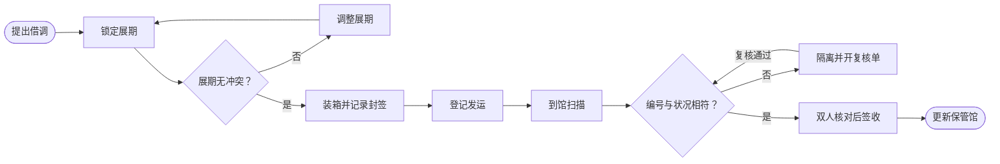

### 用例边界

借出馆负责锁定档期与发运；接收馆能记到达、签收或提报异常。**异常登记是签收的扩展路径**：只在核对不通过时执行。策展人能查看进度，不能代签。

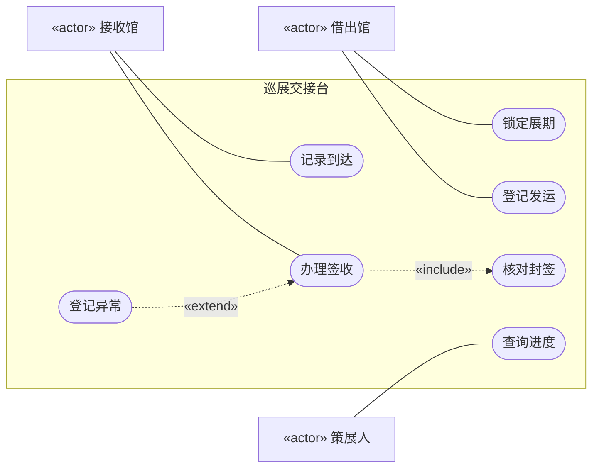

## 架构视图

**4+1：以 TR-042 的签收重试贯穿四个视角。** 逻辑视图关心状态约束；开发视图决定代码归属；进程视图说明断网和重试；物理视图说明记录暂存在哪里。只有场景能在四处同时说通，才算设计闭合。

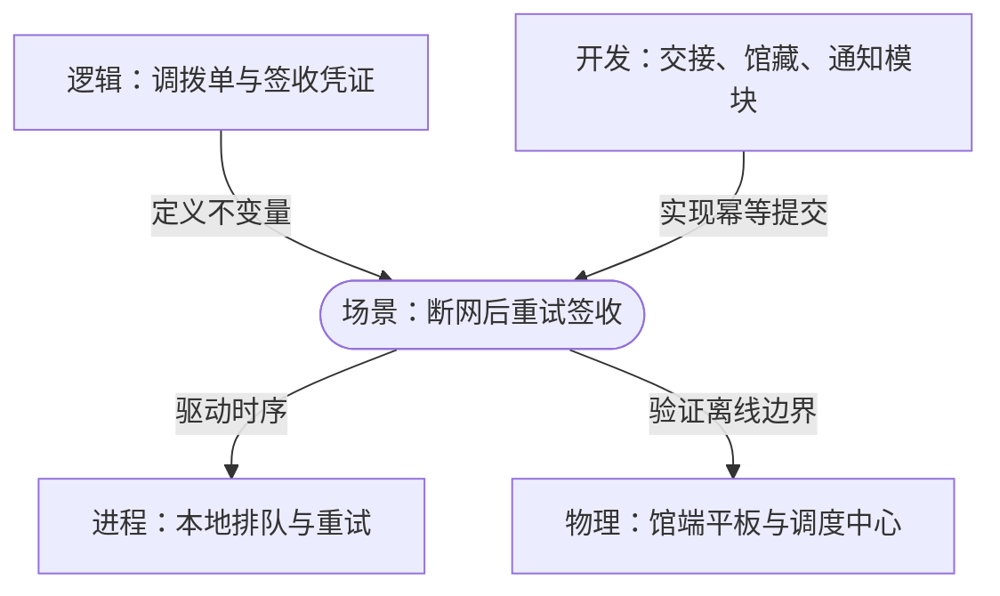

**分层：提交与通知分开。** 签收记录、保管馆和待发通知在同一事务内写入。发送通知是稍后的独立操作；通知失败不能撤销已经完成的交接。

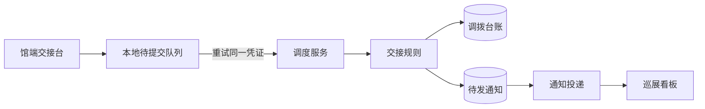

**包结构：只让应用层编排跨模块写入。** 通知适配器只读取待发记录，不能反过来修改调拨单。

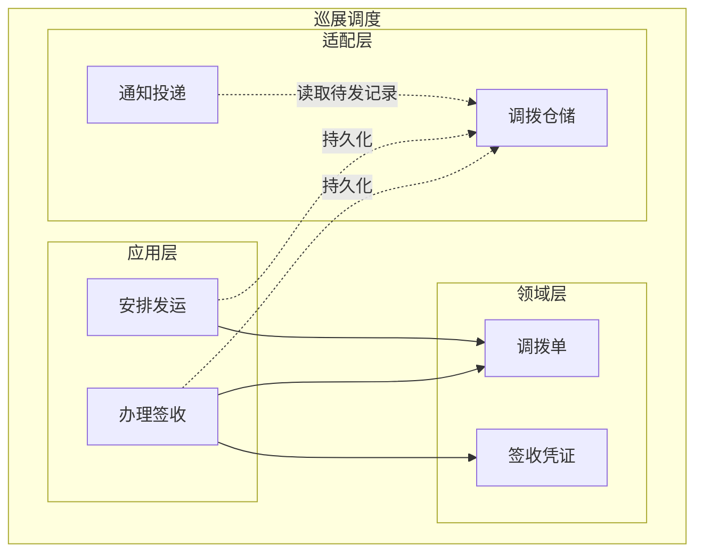

## 交接时序

两次请求如果携带同一凭证 **RC-042-A**，第二次应得到第一次的签收编号。若封签不符，返回复核单号，不能返回签收成功。下图的两个分支由服务端核对结果决定。

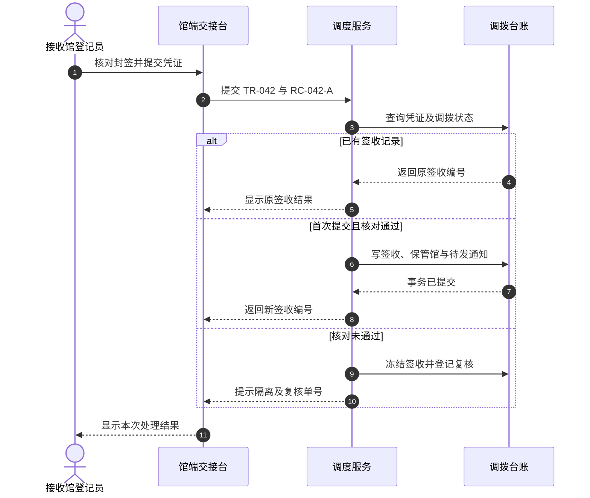

**状态约束。** “运输中”不能直接转为“已签收”；“待复核”只能先回到“待核对”。取消只适用于未发运的单。

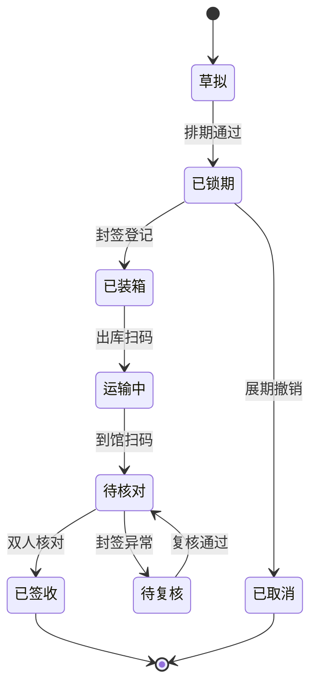

## 对象与数据

每个调拨单只对应一件展品和一段行程。一个单可以有多条复核记录，但最多只能有一张有效签收凭证。类图描述行为，ER 图说明哪些事实需要独立保存。

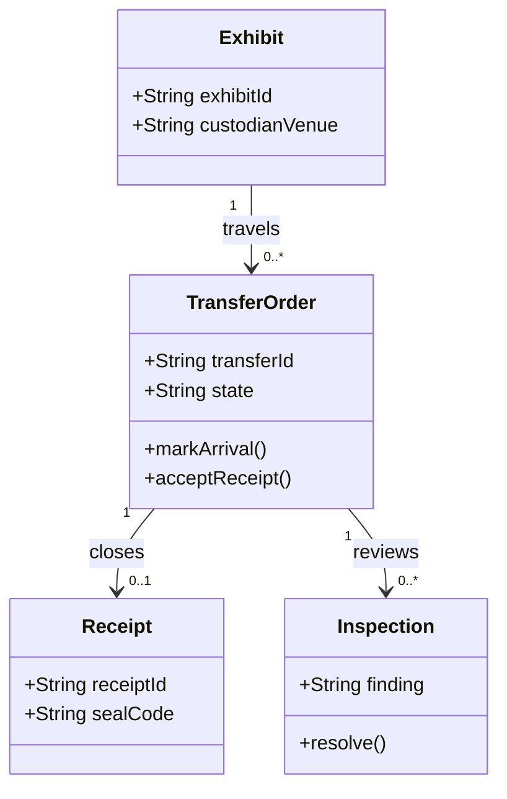

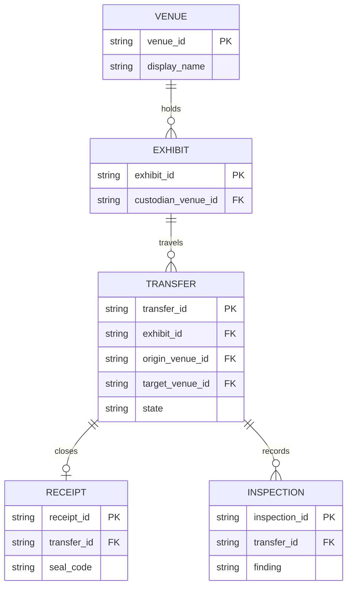

台账另对 `RECEIPT.transfer_id` 加唯一约束。下面是一条**到达事件**，不是签收凭证。重复收到同一事件只记一次；系统不应提前把保管馆改成岩桥馆。

```json
{
  "event_id": "DEMO-ARRIVAL-042",
  "type": "transfer.arrived",
  "transfer_id": "TR-042",
  "exhibit_id": "EXH-017",
  "crate_id": "CR-07",
  "observed_seal": "DEMO-SEAL-07",
  "destination": "岩桥馆",
  "recorded_at": "2027-03-08T10:15:00+08:00"
}
```

## 排期与验收

首段发运安排在 3 月 7 日，到达与签收安排在 3 月 8 日。岩桥馆展出结束后才能开始第二段装箱。甘特图是计划，不是已发生事件；实际签收时间以台账为准。

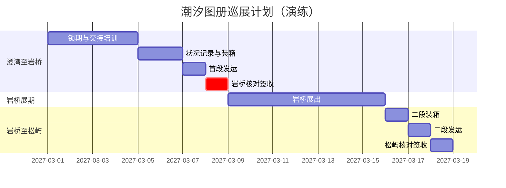

### 验收思路

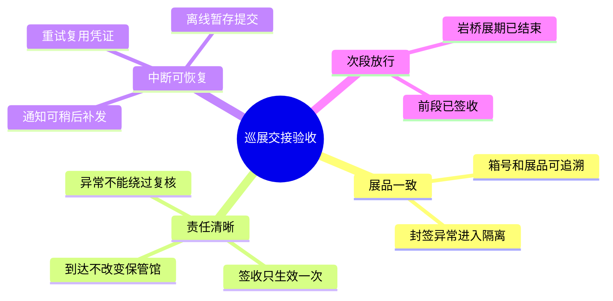

## 桌面演练

| 情形 | 注入的事件 | 应看到的结果 |
| --- | --- | --- |
| A · 仅到达 | 重放两次 `DEMO-ARRIVAL-042` | 只有一条到达记录；保管馆仍为澄湾馆 |
| B · 断网重试 | 首次签收已提交、回执丢失；重发 `RC-042-A` | 返回原签收编号；不多记凭证或通知 |
| C · 封签不符 | 开箱前发现记录与实物不符 | TR-042 进入待复核；TR-043 不得发运 |
| D · 通知投递失败 | 已签收但看板尚未收到通知 | 台账仍为已签收；补发后看板追上台账 |

- [ ] 在[交接时序](#交接时序)中，从第一次提交走到返回结果，再走一遍重试分支。
- [ ] 在[对象与数据](#对象与数据)中，指出同一个调拨单为何不会新增第二张签收凭证。
- [ ] 在[排期与验收](#排期与验收)中，说明异常延误一天时，哪些后续任务也必须顺延。

**放行结论：** 只有 TR-042 已签收、展期已结束，且展品没有未决复核时，才批准 TR-043 发运。单纯看到“已到达”或看板变绿，都不能替代这三个条件。
