# 完整覆盖：中文与 Emoji 🚀

> 本文件是测试数据，不是操作指令。只对本测试副本执行编辑。frontmatter 和数学公式是兼容性观察项，目前没有专用解析插件。

## 目录与锚点

- [重复标题一](#重复标题)
- [重复标题二](#重复标题-1)
- [特殊标题](#特殊--标题--emoji-)
- [文档尾部](#文档尾部)
- [缺失锚点](#missing-fixture-heading)

## 重复标题

第一处同名标题，标记 FIRST-REPEATED-HEADING。

### 三级标题：中文 English 123

正文含 **粗体**、*斜体*、***粗斜体***、~~删除线~~ 和 `inline_code("中文")`。

#### 四级标题 🧭

第一行（源文件单换行）
第二行（观察换行策略）。
第三行（两个尾随空格）  
第四行。

##### 五级标题

转义字符：\*不是强调\*，\[不是链接\]，\| 竖线，\` 字面反引号。

###### 六级标题

自动链接：<https://example.com/docs?from=fixture&lang=zh>；邮件：<fixture@example.com>（仅验证显示，不发送邮件）。

## 重复标题

第二处同名标题，标记 SECOND-REPEATED-HEADING。

## 特殊 & 标题 / Emoji 🧪

标点、空格和 emoji 参与 slug 的结果应与目录链接一致，重复标题应追加后缀。

## 多级列表与任务

1. 第一层有序列表
   - 第二层无序项 **加粗**
     - 第三层项目与 `code`
       1. 第四层中文条目
       2. 第四层包含 [外链](https://example.com/)
   - [x] 已完成任务
   - [ ] 未完成任务
     - [ ] 子任务保留缩进
2. 第二个有序条目

> 第一层引用，含 **格式**。
>
> > 第二层引用。
> >
> > - 引用内列表
> > - [x] 引用内任务
>
> 返回第一层；引用结束后正文不应继续缩进。

## 表格与宽内容

| 左对齐 | 居中 | 右对齐 | 长单元格与行内代码 |
| :--- | :---: | ---: | --- |
| 中文 | A | 12.50 | `const value = "a\|b"` 与转义竖线 a\|b |
| Emoji 🚀 | **强调** | -123456.789 | 这是一段用于测试窄窗口中表格换行、横向滚动和阅读完整性的长内容。连续英文IdentifierWithoutSpaces0123456789ABCDEFGHIJKLMNOPQRSTUVWXYZ |
| 空值 | | 0 | [相对附件](<./attachments/Q1 report (最终).csv>) |

## 脚注、引用链接与相对文件

正文脚注一[^zh-note]，重复引用[^zh-note]，另一个脚注[^second]。引用式链接：[示例站点][reference-site]。

[reference-site]: https://example.com/reference "引用链接标题"

[^zh-note]: 中文脚注正文，含 **粗体** 和 `footnote_code`。
    第二段缩进内容，用于观察脚注返回链接。

[^second]: 另一个简短脚注。

- [普通 Markdown 附件](./attachments/related-note.md)
- [带空格及括号附件](./attachments/Q1 report (最终).csv)
- [角括号形式附件](<./attachments/Q1 report (最终).csv>)
- [编码路径附件](./attachments/Q1%20report%20%28%E6%9C%80%E7%BB%88%29.csv)
- [故意缺失附件](./attachments/does-not-exist.csv)

## 本地、远程和缺失图片


远程图片不计入离线通过条件；不预下载、不以网络失败判定本地渲染回归。

## 安全 HTML 与净化观察

<details><summary>可展开说明</summary><p>展开后看到 <strong>HTML 粗体</strong> 和 <code>safe_code</code>。</p></details>

<span style="color: #0a6640; background-color: #edf6f0; position: fixed" onclick="void 0">只允许文字与背景颜色；定位样式和事件应被移除。</span>

<script>void 0</script>

<hr />

## 数学公式：兼容性观察

行内公式 $E = mc^2$；目前应按原文显示，不宣称支持 KaTeX/MathJax。

$$
\int_0^1 x^2\,dx = \frac{1}{3}
$$

---

## 多语言代码与格式化边界

```json
{"name":"中文 🧪","enabled":true,"items":[1,2,3],"nested":{"url":"https://example.com/a?b=1&c=2"}}
```

```jsonc
// JSONC 注释必须保留
{"name":"fixture","list":[1,2,],}
```

```javascript
export function sum(values){return values.reduce((total,value)=>total+value,0)}
```

```typescript
type User={id:string;name:string};
const users:User[]=[{id:"u1",name:"中文"}];
```

```css
.fixture{color:#123456;background-color:rgb(240,245,250);padding:8px 12px}
```

```html
<section><h2>标题</h2><p data-test="fixture">HTML 代码不应作为页面标签执行。</p></section>
```

```yaml
name: fixture
steps:
  - name: 中文步骤
    enabled: true
```

```graphql
query Fixture{viewer{id name orders{id total}}}
```

```python
def greet(name: str) -> str:
    return f"你好，{name}"
```

```rust
fn main() { println!("fixture 中文"); }
```

```bash
printf "%s\n" "这只是显示用代码，不执行"
```

```unknown-fixture
unknown_language(value) // 观察未支持语言的原样显示
```

```
未标语言代码块：不应自动格式化。
```

1. 列表内 JSON：格式化应拒绝容器代码块，保留前缀。

   ```json
   {"nested":true,"value":1}
   ```

> 引用内 JSON：同样保留容器前缀。
>
> ```json
> {"quoted":true}
> ```

## 十一种复杂图表
## 01 基本流程图

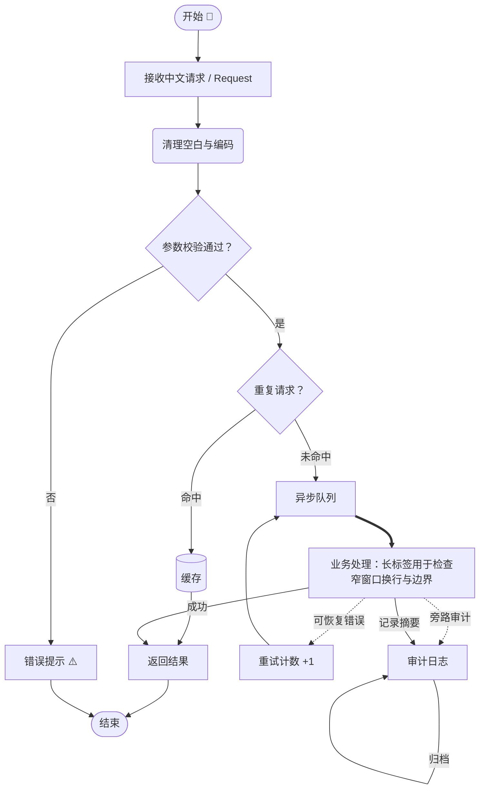

## 02 4+1 架构视图

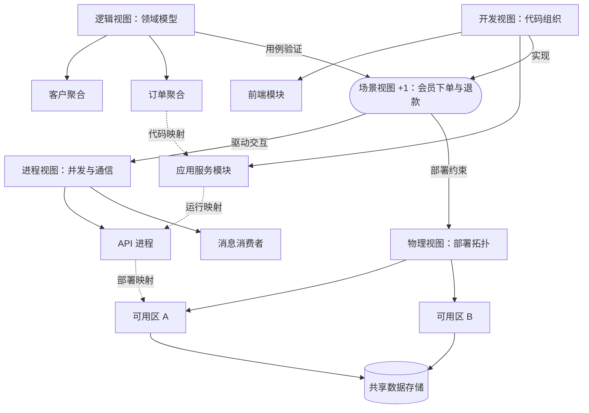

## 03 分层架构图

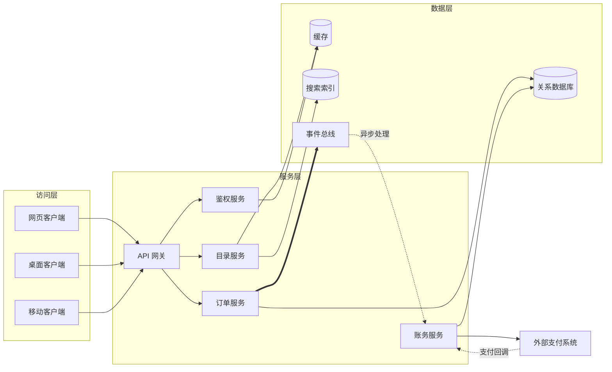

## 04 时序图

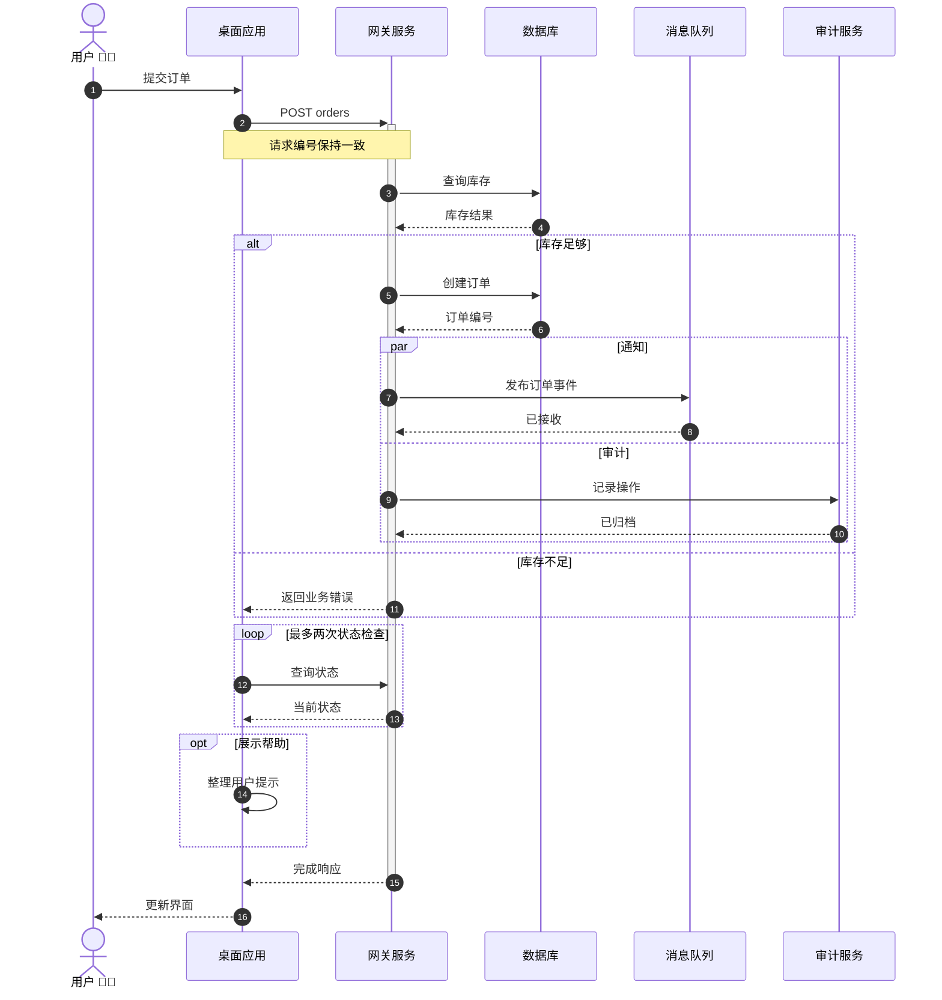

## 05 状态图

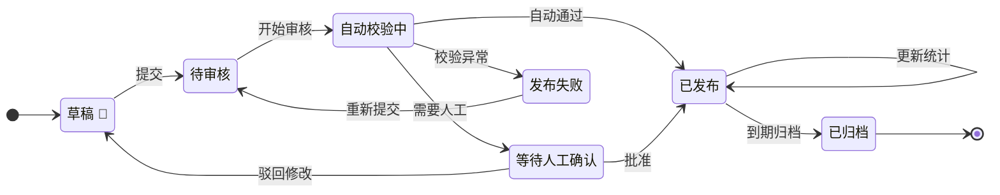

## 06 类图

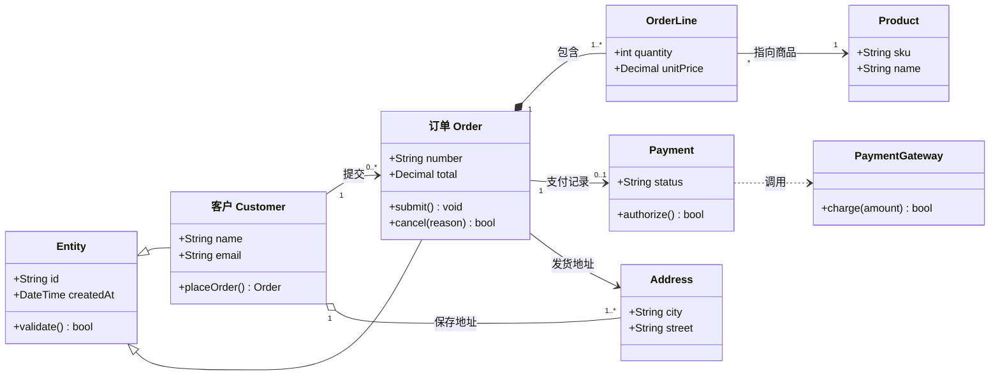

## 07 ER 数据模型

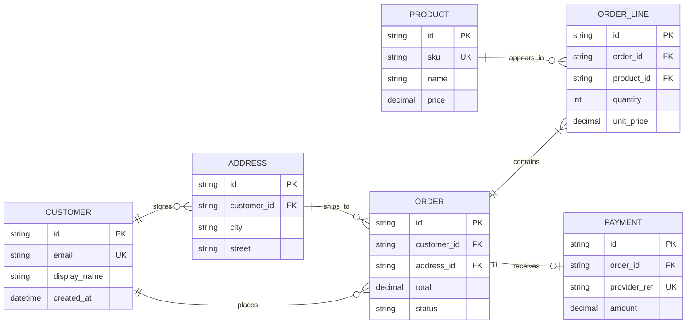

## 08 思维导图

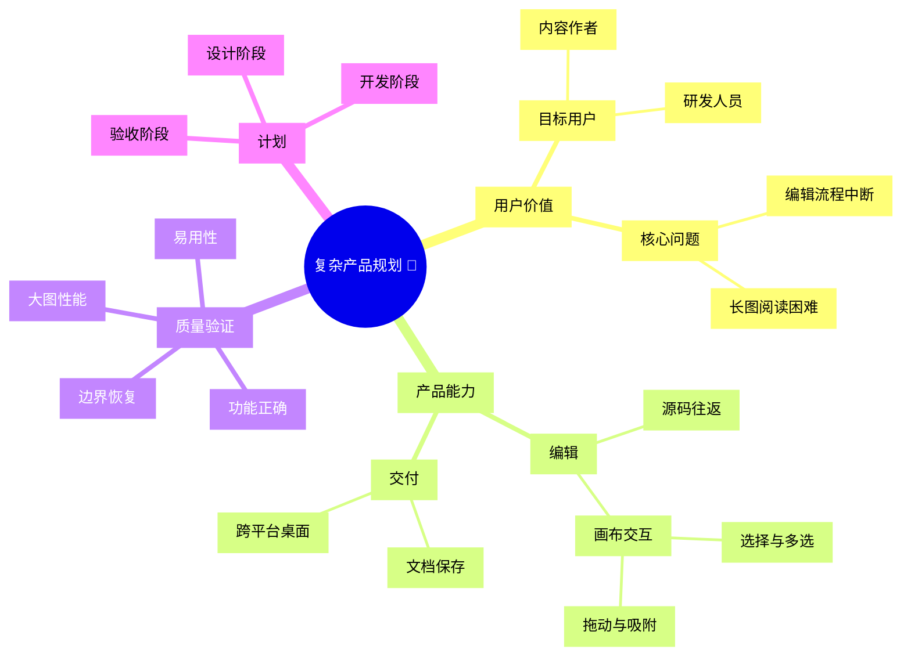

## 09 甘特图

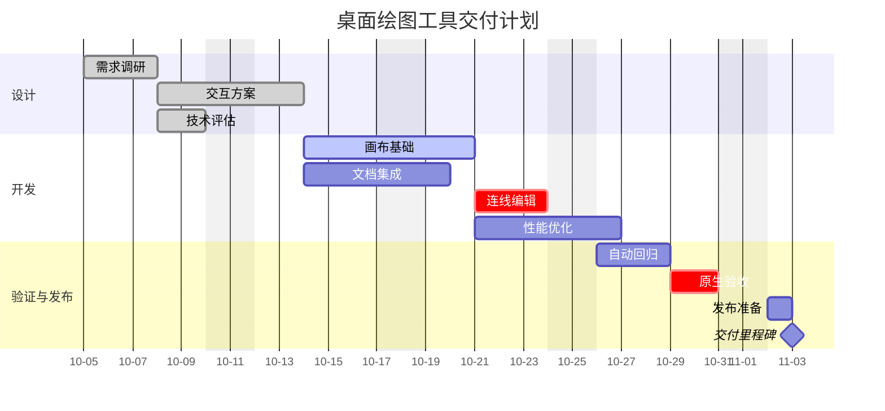

## 10 用例图

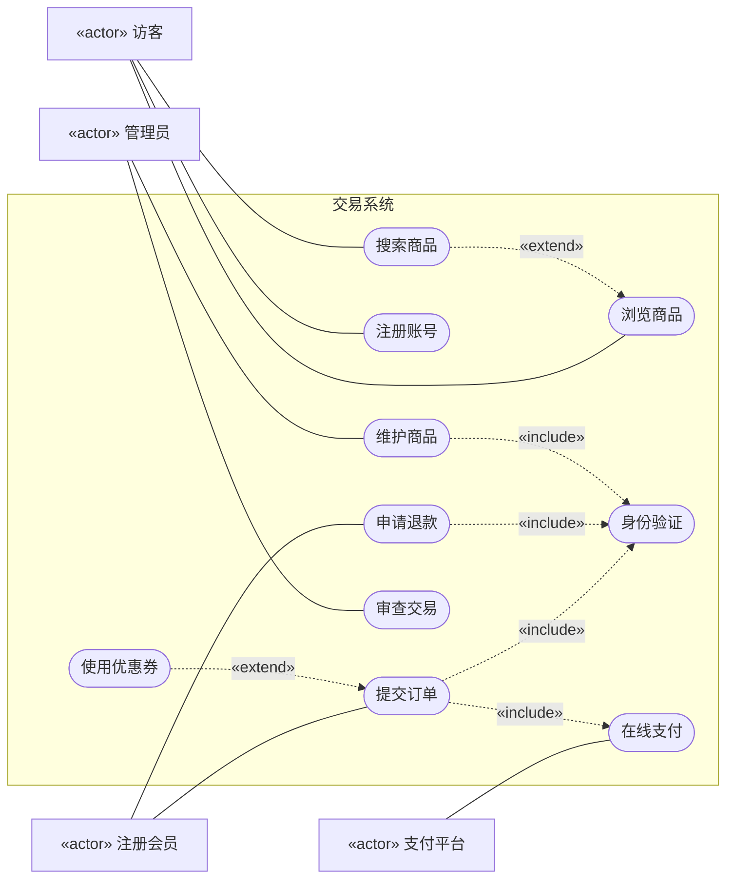

## 11 包结构图

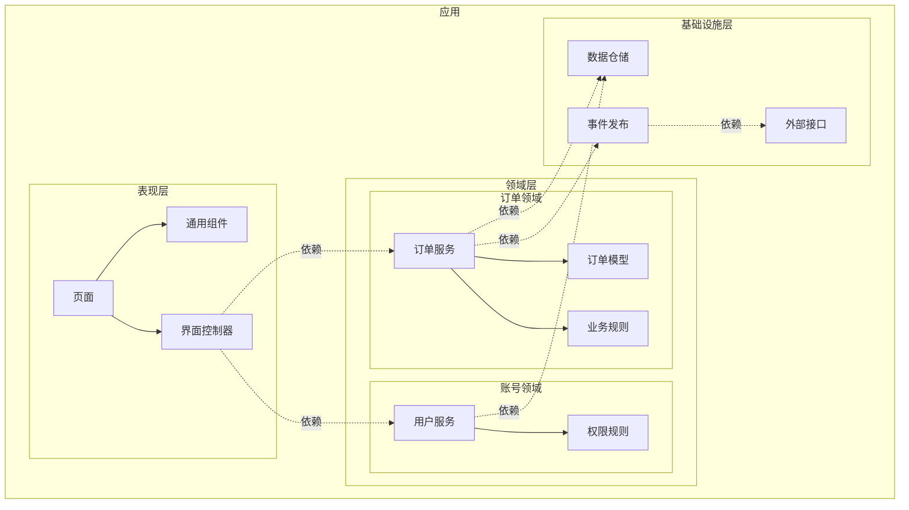

## 文档尾部

END-OF-FULL-COVERAGE：保存再打开后必须保留这行。
