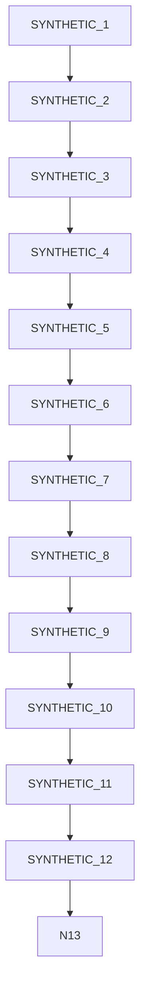

# SYNTHETIC_SCROLL_ACCEPTANCE

Synthetic local scroll acceptance fixture.

## SYNTHETIC_SECTION_01

Paragraph 01: synthetic reading context.
Second line for section 01.

## SYNTHETIC_SECTION_02

Paragraph 02: synthetic reading context.
Second line for section 02.



## SYNTHETIC_SECTION_03

Paragraph 03: synthetic reading context.
Second line for section 03.

## SYNTHETIC_SECTION_04

Paragraph 04: synthetic reading context.
Second line for section 04.

## SYNTHETIC_SECTION_05

Paragraph 05: synthetic reading context.
Second line for section 05.

| Synthetic key | Value |
| --- | --- |
| ROW_1 | Synthetic 1 |
| ROW_2 | Synthetic 2 |
| ROW_3 | Synthetic 3 |
| ROW_4 | Synthetic 4 |
| ROW_5 | Synthetic 5 |
| ROW_6 | Synthetic 6 |
| ROW_7 | Synthetic 7 |
| ROW_8 | Synthetic 8 |
| ROW_9 | Synthetic 9 |
| ROW_10 | Synthetic 10 |
| ROW_11 | Synthetic 11 |
| ROW_12 | Synthetic 12 |
| ROW_13 | Synthetic 13 |
| ROW_14 | Synthetic 14 |
| ROW_15 | Synthetic 15 |
| ROW_16 | Synthetic 16 |
| ROW_17 | Synthetic 17 |
| ROW_18 | Synthetic 18 |
| ROW_19 | Synthetic 19 |
| ROW_20 | Synthetic 20 |
| ROW_21 | Synthetic 21 |
| ROW_22 | Synthetic 22 |
| ROW_23 | Synthetic 23 |
| ROW_24 | Synthetic 24 |

## SYNTHETIC_SECTION_06

Paragraph 06: synthetic reading context.
Second line for section 06.

## SYNTHETIC_SECTION_07

Paragraph 07: synthetic reading context.
Second line for section 07.

## SYNTHETIC_SECTION_08

Paragraph 08: synthetic reading context.
Second line for section 08.


## SYNTHETIC_SECTION_09

Paragraph 09: synthetic reading context.
Second line for section 09.

## SYNTHETIC_SECTION_10

Paragraph 10: synthetic reading context.
Second line for section 10.

## SYNTHETIC_SECTION_11

Paragraph 11: synthetic reading context.
Second line for section 11.

```text
SYNTHETIC_CODE_0
SYNTHETIC_CODE_1
SYNTHETIC_CODE_2
SYNTHETIC_CODE_3
SYNTHETIC_CODE_4
SYNTHETIC_CODE_5
SYNTHETIC_CODE_6
SYNTHETIC_CODE_7
SYNTHETIC_CODE_8
SYNTHETIC_CODE_9
SYNTHETIC_CODE_10
SYNTHETIC_CODE_11
SYNTHETIC_CODE_12
SYNTHETIC_CODE_13
SYNTHETIC_CODE_14
SYNTHETIC_CODE_15
```

## SYNTHETIC_SECTION_12

Paragraph 12: synthetic reading context.
Second line for section 12.

## SYNTHETIC_SECTION_13

Paragraph 13: synthetic reading context.
Second line for section 13.

## SYNTHETIC_SECTION_14

Paragraph 14: synthetic reading context.
Second line for section 14.

## SYNTHETIC_SECTION_15

Paragraph 15: synthetic reading context.
Second line for section 15.


## SYNTHETIC_SECTION_16

Paragraph 16: synthetic reading context.
Second line for section 16.

## SYNTHETIC_SECTION_17

Paragraph 17: synthetic reading context.
Second line for section 17.

## SYNTHETIC_SECTION_18

Paragraph 18: synthetic reading context.
Second line for section 18.

## SYNTHETIC_SECTION_19

Paragraph 19: synthetic reading context.
Second line for section 19.

## SYNTHETIC_SECTION_20

Paragraph 20: synthetic reading context.
Second line for section 20.

